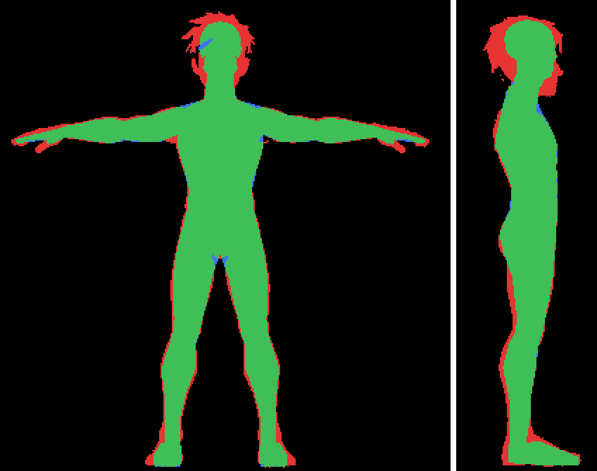
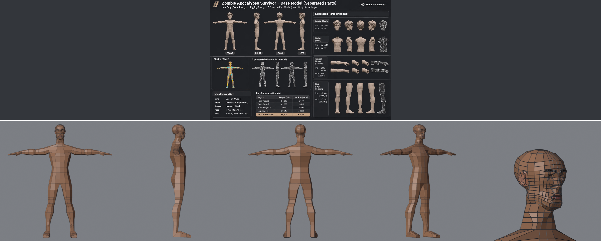
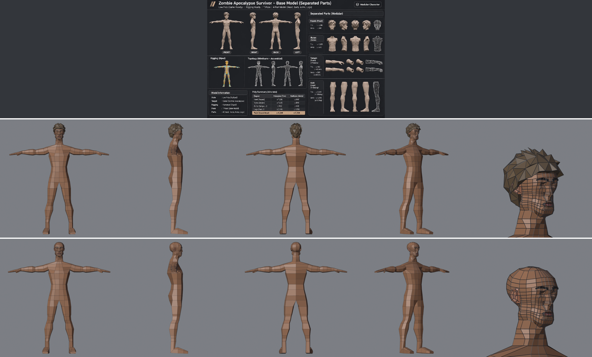
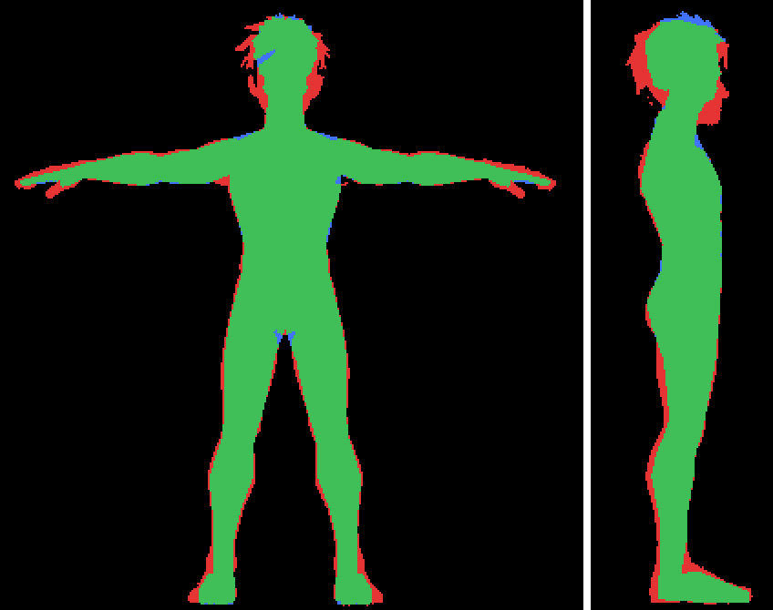
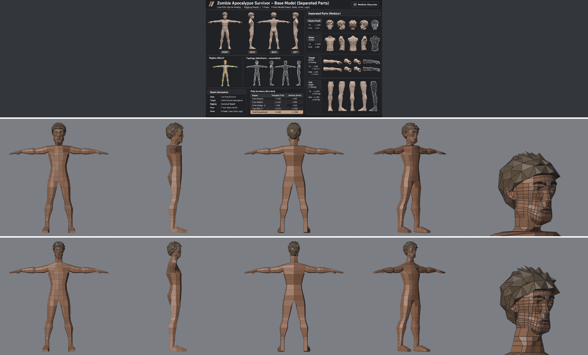
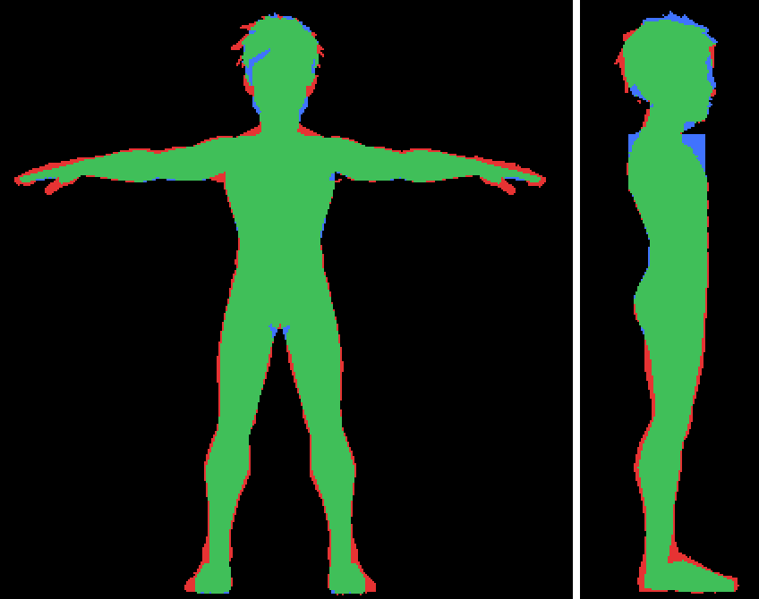
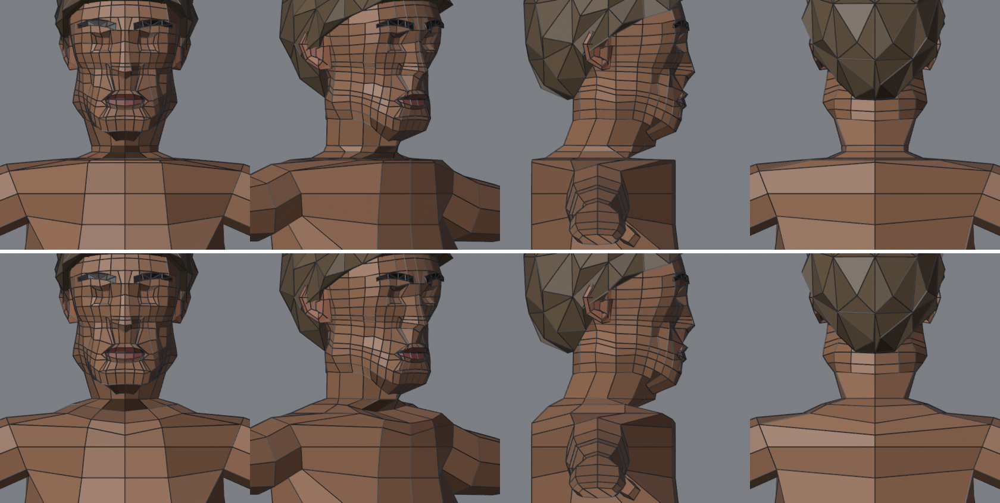
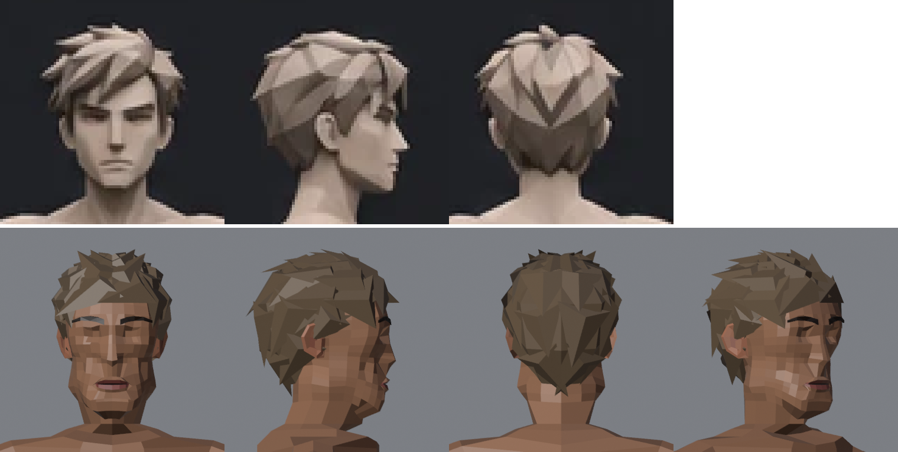

# Alat QA (evaluasi model)

Alat untuk gerbang E1–E3 dan ekspor di [Pipeline karakter dan evaluasi](pipeline-karakter-dan-evaluasi.md).
Semuanya di `tools/qa/`, jalan di Blender headless pada file `.blend` mana pun. File sumber tidak pernah disimpan ulang.

## Sekali jalan (semua alat)
```powershell
.\tools\qa\qa.ps1 output\ref\survivor\head_ref_body_v5base_color.blend -Budget 3000 -Height 1.78 `
    -Measure output\ref\survivor -Ref notes\attachments\ref\survivor_sheet.webp [-Compare versi_lama.blend] [-Asym]
```
Hasil di `output/qa/<nama>_*`: `_eval.json`, `_iou.json` + `_iou.png`, `_sheet.png`, `.glb`, `_export.json`.

## Alat satu per satu
| Alat | Gerbang | Isi |
|---|---|---|
| `eval_model.py` | E1 | tris vs budget, tertutup, normal konsisten dan ke luar, sampah geometri (titik dobel, lepas, face dalam, luas nol), simetri seluruh model, porsi quad, porsi sliver buruk (segitiga asli / quad terlipat), kaki di lantai, tinggi, cincin di lutut/siku (perkiraan), UV tumpang tindih, bobot skin, `--export` = uji glb |
| `silhouette_iou.py` | E2 | mask putih model dirender pada skala piksel referensi; IoU depan dan samping, IoU per pita (kepala, badan + lengan, kaki), landmark (leher, bahu, ketiak, selangkangan, pergelangan kaki, ujung tangan) dari kode `ref_measure.py` yang sama |
| `sheet.py` | E3 | satu baris per model: depan, samping kanan, belakang, 3/4, close-up kepala; flat + wire; `--ref` gambar referensi di atas, `--compare` versi lama di bawah |
| `export_glb.py` | ekspor | warna face disalin ke CORNER, ekspor glb (modifier diterapkan), lalu dibaca ulang: jumlah tris sama, COLOR_0 ada, skin ada kalau ada armature |
| `qa_common.py` | | helper bersama: argumen setelah `--`, mesh hasil modifier di ruang dunia, kamera ortho, simpan/baca PNG |

## Uji pertama: survivor v5base (4 Nov 2026)
E1: 21 dari 25 lulus.
- **Lulus:** 2218 tris (budget 3000), semua part tertutup, normal benar, simetris, quad 88 %, glb utuh dengan warna.
- **Gagal:**
  - sliver 4.2 %, butuh ≤ 2 %;
  - tinggi 1.742 m, padahal brief 1.78 m;
  - cincin di lutut dan siku masing-masing 2, butuh ≥ 3 untuk rig.

E2:
- **IoU:** depan 0.868, samping 0.836.
- **Per pita:** badan + lengan 0.92 / 0.94, kaki 0.88 / 0.84, kepala 0.57 / 0.61.
- Kepala rendah karena **rambut belum ada**: merah di sekitar kepala pada gambar.
- **Landmark:** bahu, ketiak, selangkangan, pergelangan kaki, dan ujung tangan lulus. Leher terlalu tinggi 5.5 cm, puncak kepala kurang 3.8 cm (rambut lagi).




Artinya untuk survivor: rambut dulu (naikkan IoU kepala), tambah loop di lutut dan siku, turunkan leher, dan rapikan sliver.

## Perbaikan survivor dari temuan QA: v7 (4 Nov 2026)
Langkah build:
1. `RB_HEAD=output/head-game/template/head_masc_v1.blend RB_TAG=ref_body_v7base` → `ref_body.py`
2. `head_paint.py` (`PAINT_TAG=ref_body_v7base_color`)
3. `hair_lowpoly.py` → `output/ref/survivor/survivor_v7.blend`

| Temuan v5base | Perbaikan | v7 |
|---|---|---|
| 2 cincin di lutut | `leg_y`: lutut +5 cm, tepat di lutut, −5 cm (rig menekuk di cincin tengah) | 3 ✓ |
| 2 cincin di siku | cincinnya sudah 3 (x 0.37/0.40/0.42); **alat salah tebak posisi siku** → siku = tengah bahu (0.12 H) dan pergelangan (ujung − 0.11 H) | 3 ✓ |
| tinggi 1.742, puncak kurang 3.8 cm | rambut (`hair_lowpoly.py`) | 1.791 m ✓ |
| IoU kepala 0.57 / 0.61 | rambut | 0.71 / 0.72 |
| sliver 4.2 % | ukuran diganti (lihat bawah); tidak ada geometri yang diubah | 2.0 % (pas batas) |

Hasil: E1 **30/30 lolos** (budget 6200 tris dari lembar referensi, total 2506 tris). E2 IoU depan 0.882, samping 0.859, masih di bawah 0.90.




### Rambut: dua percobaan
- **Percobaan 1:** muka kulit kepala template yang rapat (96 muka) dipertebal, lalu tiap muka ditusuk (poke) jadi gumpalan. Hasilnya seperti buah pinus: ratusan duri kecil. Melanggar gaya bidang besar.
- **Percobaan 2 (dipakai):** kubah kasar milik sendiri, 12 sektor × 4 baris + kutub. Tiap titik di-*ray cast* dari pusat kepala ke kulit. Baris bawah mengikuti garis rambut: tinggi di dahi, di atas telinga, turun sampai tengkuk. Hasilnya 48 gumpalan besar dan 288 tris.
- Arah gumpalan: atas dan belakang ke belakang-bawah; poni ke depan-bawah, menyapu ke kanan karakter dan berhenti di atas alis; samping ke bawah.
- **Pelajaran:** jumlah gumpalan ditentukan oleh kerapatan dasar, jadi buat dasar sendiri yang kasar. Jangan memakai topologi kepala yang rapat.

### Sisa (butuh penilaian user)
- **Rahang lebih sempit dari leher**, jadi landmark "leher" terbaca di 1.544 (ref 1.489). Dari depan, lebar model di tinggi 1.52–1.60 sekitar 0.10–0.13 m, sedangkan referensi 0.15–0.20 m. Sebagian selisih itu rambut samping referensi, sebagian rahang template yang kecil.
- Kaki IoU 0.88 / 0.85: betis dan telapak referensi lebih besar.
- Rambut v1 masih seperti helm berduri di bagian belakang. Referensi punya gumpalan yang lebih panjang, menumpuk, dan menyapu satu arah.

## v8: rahang, sebenarnya ukuran kepala (4 Nov 2026)
User memilih "rahang dulu". Pengukuran baris per baris dari gambar referensi (zoom 10×, grid 5 px, hanya kulit wajah) menunjukkan masalahnya bukan rahang saja: **seluruh kepala model terlalu kecil**.

| | Referensi | v7 |
|---|---|---|
| dagu | 1.465 m | 1.523 m |
| alis | 1.62 m | 1.66 m |
| tengkorak sampai dagu | ±0.28 m | 0.22 m |
| lebar rahang (z 1.54) | 0.17 m | 0.10 m |

**Sebab:** `place_head` memasang cincin tabung leher template (`CHIN_T` −0.153) ke landmark "leher" siluet. Dagu aslinya jadi 3.4 cm di atasnya, kepala kecil, leher panjang. Landmark "leher" siluet depan sebenarnya baris dagu, karena dagu dan leher menyatu di siluet.

**Perbaikan** (`ref_body.py`, `RB_HEAD_FIT=chin`, bawaan):
- dagu asli template (titik terendah di 3 cm paling depan) dipasang ke `L["chin"] − CHIN_DROP` (0.024, diukur dari gambar);
- puncak tengkorak tetap di tempat;
- skala kepala naik 1.009 → 1.301;
- pangkal leher ditaruh minimal `NECK_GAP` di bawah loop rahang, lebarnya dibatasi `NECK_FLARE` × leher tersempit.

| | v7 | v8 |
|---|---|---|
| IoU depan / samping | 0.882 / 0.859 | **0.891 / 0.881** |
| IoU pita kepala | 0.71 / 0.72 | **0.84 / 0.86** |
| E1 | 30/30 | 29/30 (sliver buruk 2.3 %) |




**Efek samping: rak di pangkal leher.** Kepala besar membuat loop rahang turun ke 1.435, sedangkan atas bahu (lengan T-pose) di 1.406. Hanya ada 3 cm, jadi leher 0.12 m langsung melebar jadi bahu 0.26 m di 1.41 (rak datar). Referensi melebar bertahap dari 1.45 ke 1.41 (0.13 → 0.16 → 0.20 → 0.25). Sliver buruk baru ada di 1.41 (10) dan di rahang yang diperbesar, 1.49–1.54 (20). Memperlebar pangkal leher (`NECK_FLARE` 1.15 → 1.4) hampir tidak berpengaruh: masalahnya ruang vertikal, bukan lebar. Perbaikan berikutnya: cincin lereng trapezius yang miring (sisi leher lebih rendah dari depan dan belakang), menunggu keputusan user.

## v9: lereng trapezius (4 Nov 2026)
User: "Ya, bikin lereng". Atas = v8, bawah = v9 (depan, 3/4, samping, belakang):


- **Rencana awal** (pangkal leher mengikuti kemiringan loop rahang) **gagal**: loop rahang template datar, semuanya di 1.435.
- **Dipakai** (`NECK_TILT`, bawaan di `ref_body.py`):
  - cincin tengah leher dibuang, jadi loop rahang langsung ke pangkal leher;
  - pangkal leher dimiringkan per kolom lewat `TRAP_LIFT`: depan tetap di tenggorokan (1.413), samping naik ke 1 cm di bawah rahang (1.425), belakang 0.7 (1.421);
  - lebar sisi dibatasi `TRAP_FLARE` 1.55 × leher tersempit;
  - bidang dari tepi ini turun ke baris trapezius dan bahu, jadi lereng.
- **Pita jarum di dada dan punggung:** baris trapezius (1.410) dan baris atas lengan (1.406) hanya berjarak 4 mm di kolom tengah. Untuk kolom 0, 22 (60 %), dan 180, dua baris itu disebar rata dari tenggorokan ke baris 3 (`MID_SPREAD`). Hasilnya garis V di tulang dada.

| | v8 | v9 |
|---|---|---|
| landmark leher | 1.434 ✗ | **1.456 ✓** (ref 1.489) |
| IoU depan / samping | 0.891 / 0.881 | 0.894 / 0.881 |
| sliver buruk | 2.3 % (10 di 1.41) | **2.01 %** (0 di leher) |

Sisa sliver (39) ada di rahang template yang diperbesar (z 1.49–1.54, 20) dan di telapak kaki (18). E1 gagal tipis (2.01 % vs 2 %).
**Pelajaran:** kepala besar = leher pendek. Lereng trapezius harus mulai langsung dari loop rahang; cincin leher datar di antaranya menjadi rak.

## v10: rambut berlapis (4 Nov 2026)
User memilih "Rambut". Atas: referensi (depan, samping, belakang). Bawah: v10 (depan, samping, belakang, 3/4).


`hair_lowpoly.py` v2:
- **Shell** tetap kubah kasar, tapi tipis (8–16 mm) dan tidak ditusuk lagi: jadi lapisan dasar.
- **Satu baji tertutup per muka kubah** (4 segitiga):
  - pangkal di sisi hulu: 2 sudut 4 mm di bawah shell, ditambah punggung setebal `WEDGE_THICK` 1.8 cm;
  - ujung jauh ke hilir sepanjang arah sisiran (5–9.5 cm), jadi tiap gumpalan menimpa pangkal baris berikutnya seperti genteng;
  - lebar 0.62 × muka, jadi tetangga di kiri-kanan ikut bertumpuk.
- **Arah sisiran:**
  - poni: satu sapuan melintang ke kanan karakter, berhenti 1 cm di atas alis;
  - atas: ke belakang, ujung sedikit terangkat (duri di ubun-ubun);
  - samping: ke belakang-bawah;
  - belakang: ke bawah melewati tengkuk, sehingga bibir shell tertutup dan terbentuk V seperti referensi.
- 10 sektor, 40 gumpalan, 320 tris.

| | v9 (duri) | v10 (baji) |
|---|---|---|
| tampilan | helm berduri | berlapis, tersapu, V di belakang |
| IoU pita kepala depan / samping | 0.84 / 0.86 | 0.82 / 0.87 |
| E1 | 29/30 | **30/30** |

Catatan: sliver lolos tipis (1.99 %) karena tris rambut yang semuanya bersih menambah pembagi. Sliver di rahang dan telapak kaki tetap ada.
**Pelajaran:** rambut low-poly = gumpalan yang **rebah dan bertumpuk** mengikuti arah sisiran, bukan piramida yang mencuat dari permukaan. Ujung gumpalan harus melewati batas mukanya sendiri supaya menutupi baris berikutnya.

## Jebakan yang ketemu saat membuat alat
- **glTF di Blender 5.2:** `export_vertex_color="ACTIVE"` tidak menulis COLOR_0 sama sekali (tanpa error).
  Pakai `"NAME"` + `export_vertex_color_name="Color"`. Importer juga tidak memunculkan COLOR_0 sebagai atribut,
  jadi cek warna dengan membaca JSON di dalam glb, bukan dengan impor ulang.
- **Simetri per objek salah** untuk part berpasangan: `Eyebrow_L` sendiri tidak simetris, pasangannya `Eyebrow_R`.
  Cek simetri pada gabungan semua objek.
- **Menyamakan posisi tampak samping dengan bounding box** terseret rambut dan jari kaki referensi. IoU samping naik
  0.79 → 0.84 setelah geseran dipilih dengan mencari IoU terbaik (±25 px).
- Warna face (domain FACE) tidak bisa jadi `color_attributes`; Workbench butuh salinan CORNER untuk menampilkan warna.

- **Sliver mentah menyesatkan:** quad panjang yang datar, misalnya tabung kaki, dipecah jadi dua jarum, padahal dengan flat shading tidak terlihat. Gerbang sekarang hanya menghitung jarum dari segitiga asli atau dari quad yang **terlipat** (> 5° antar-bagian). Jumlah jarum total tetap dilaporkan sebagai INFO.
- `bmesh.ops.triangulate` mengubah face asli jadi segitiga, jadi `face_map` tidak bisa dipakai untuk tahu jumlah sisi aslinya. Simpan jumlah sisi di layer int sebelum triangulasi.
- **Penanda per objek:** custom property `qa_asym` membuat objek dilewati cek simetri (rambut), dan `qa_tris_ok` membuat objek dilewati hitungan porsi quad (gumpalan rambut memang segitiga).

## Batas alat (belum)
- Cincin lutut/siku hanya perkiraan (pita tinggi tetap, T-pose). Untuk A-pose belum ada.
- E4 (uji deformasi saat dipose) belum dibuat: butuh rig dulu.
- Landmark gagal dicari pada siluet yang bukan manusia T-pose; IoU tetap jalan.
