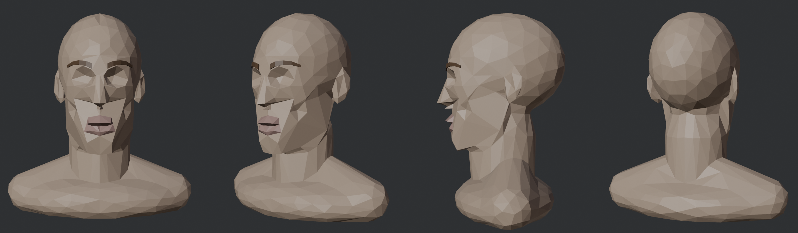
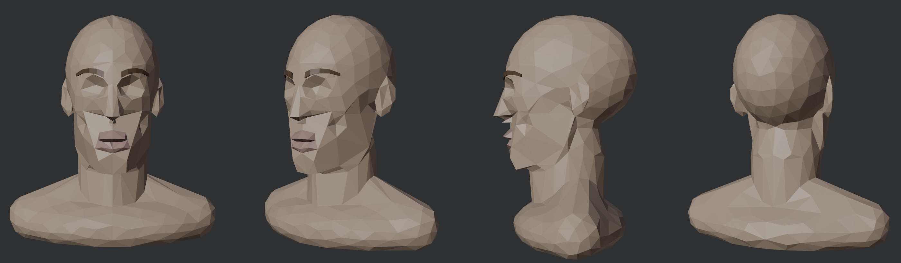
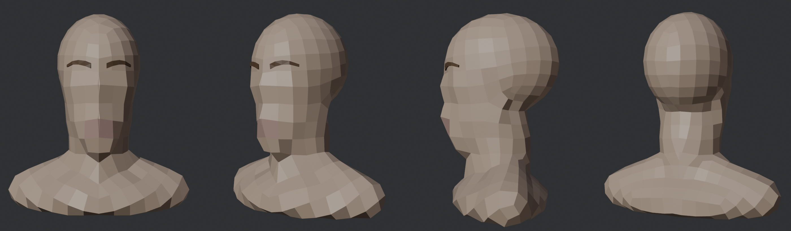
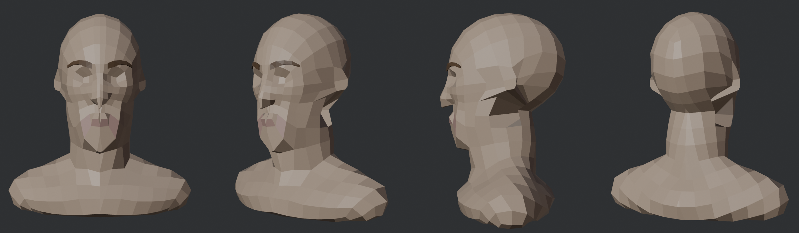
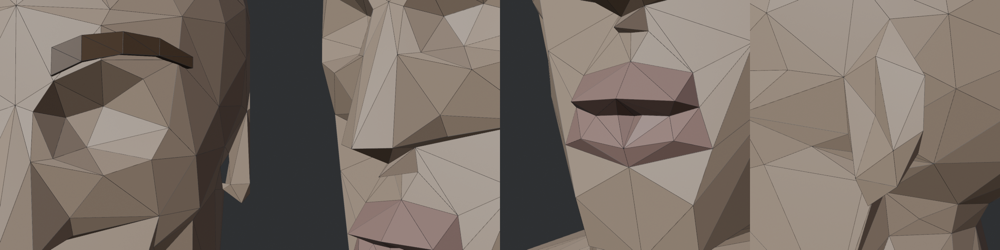
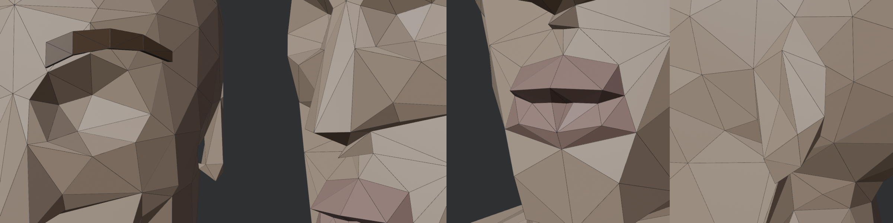

# Eksperimen topologi kepala (eyeless mid)

Ringkasan dari [docs/11](../docs/11-eksperimen-topologi.md). Tabel lengkap ada di sana. Script: `tools/blender/head_topo_lab.py`.

Pertanyaan: dengan bentuk dan budget yang sama (±900 tris), metode meshing mana yang paling bagus? Arti tiap metode ada di [Metode meshing](metode-meshing.md), arti angkanya di [Ukuran kualitas mesh](ukuran-kualitas-mesh.md).

## Hasil singkat

| Metode | Kesan visual | Catatan |
|---|---|---|
| collapse (lama) | detail bagus, segitiga acak | 26 sliver |
| QuadriFlow | quad rapi, wajah hilang | kepadatan seragam |
| QuadriFlow + warp | hidung dan mata kembali, telinga pecah | bentuk tipis susah |
| collapse_clean | segitiga rata, hidung membulat | relaksasi kena tepi tajam |
| **collapse_soft** | detail tetap, area datar rata | kompromi terbaik |
| planar dissolve, Remesh Sharp, hybrid | gagal | lihat docs/11 |

Close-up collapse vs collapse_soft:

## Pelajaran
1. **Kepadatan harus mengikuti detail.** Metode seragam (QuadriFlow) menghapus fitur yang lebih kecil dari satu quad.
2. **Struktur loop tidak bisa diharapkan dari remesh otomatis.** Loop mata dan mulut harus dirancang. Lihat [Topologi wajah low-poly](topologi-wajah-lowpoly.md).
3. **Bidang besar miring dirancang di bentuknya** (hull bersudut di SDF), bukan dari dissolve setelah meshing.
4. **Bentuk tipis (telinga)** butuh perlakuan sendiri: mesh terpisah atau patch template.
5. **Merapikan harus mengunci tepi tajam.** Relaksasi tanpa kunci melunakkan hidung dan bibir.
6. Penilaian user (2 Nov): QuadriFlow strukturnya oke tapi kurang detail; collapse detailnya bagus tapi ada segitiga tidak proporsional, cekungan, dan patahan; mulut masih kurang di semua versi.

## Langkah berikut
Template topologi tetap untuk kepala: kolom dan baris fitur, cincin mata, cincin mulut, loop nasolabial, lalu snap ke SDF.
