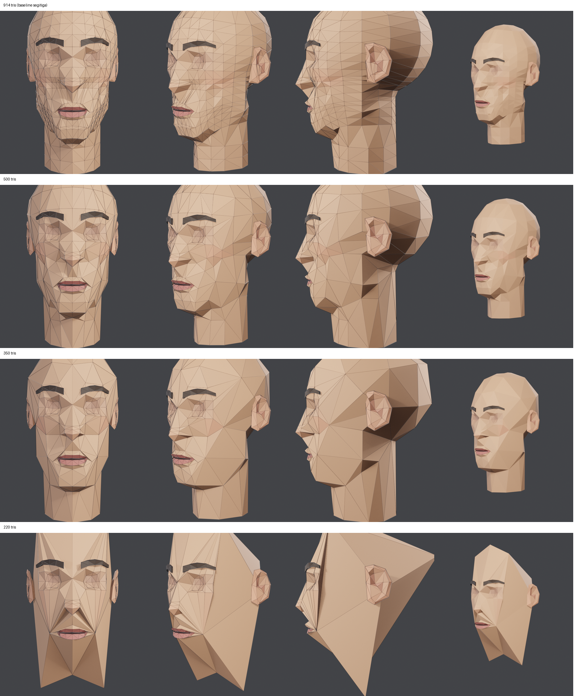
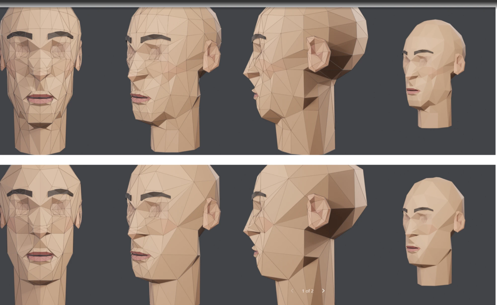

# Gaya segitiga besar (big-triangle low-poly)

Permintaan user (3 Nov 2026): "mau gaya segitiga besar", yaitu lebih sedikit segitiga dengan bidang lebih lebar, dibuat dari baseline yang sudah disetujui.
Script: `tools/blender/head_bigtri.py` (`BIG_TRIS` = target segitiga kepala). Hasil `output/head-game/template/head_big{500,350,220}*.blend`. Render: `head_paint.py` + `wire_render.py`.

## Cara
1. Mulai dari baseline (kepala v7 + telinga v13), jadi bentuk dan topologi yang sudah disetujui tetap jadi dasar.
2. **Edge-collapse QEM simetris** (Decimate COLLAPSE, symmetry X, triangulate).
3. **Lindungi fitur wajah** dengan grup vertex: bibir dan celah mulut (atribut `lips`), area mata, dan ujung hidung.
4. Cari rasio decimate dengan bisection sampai jumlah segitiga kepala tepat sama dengan target.
5. Telinga dikurangi rasio 0.6 (176 → 104 tris), alis tetap.

**Jebakan**: di Decimate Blender, grup vertex menandai bagian yang **boleh** di-collapse (bobot 0 = tidak pernah). Grup pelindung harus di-**invert**. Tanpa invert, decimate macet di 736 tris karena hanya area yang dilindungi yang boleh hilang.

## Hasil
| Target | Rasio | Jarak ke SDF mean / p95 | Penilaian |
|---|---|---|---|
| 914 (baseline segitiga) | – | 1.22 / 4.14 mm | detail penuh |
| 500 | 0.55 | 1.56 / 4.22 mm | bidang lebih besar, wajah utuh |
| **350** | 0.39 | 1.64 / 5.52 mm | **gaya segitiga besar paling bersih**: pipi, dahi, tengkorak jadi bidang lebar; mulut, mata, hidung tetap tajam |
| 220 | 0.24 | 2.26 / 6.13 mm | **rusak**: area yang dilindungi menghabiskan jatah, tengkorak runtuh jadi kerucut |

## Penilaian user
- **3 Nov 2026: 500 dan 350 DISETUJUI** ("ini sudah bagus bro"). File siap pakai: `head_big500_color.glb` dan `head_big350_color.glb`. Versi 220 tidak dipakai.

## Pelajaran
- **Batas bawah decimate yang dilindungi = jumlah segitiga di area yang dilindungi + bentuk dasar tengkorak.** Di bawah ±300 tris, perlindungan harus dikurangi (misalnya hanya bibir) atau tengkorak harus punya rangka sendiri.
- Gaya segitiga besar tidak perlu dibuat dari nol: **decimate dari template yang loop-nya sudah benar**. Fitur yang dilindungi tetap dari template, area lain menjadi bidang besar.
- Terkait: [Triangulasi quad ke segitiga](triangulasi-quad-ke-tri.md), [Metode meshing](metode-meshing.md) (collapse QEM), [Template topologi kepala](template-topologi-kepala.md).
