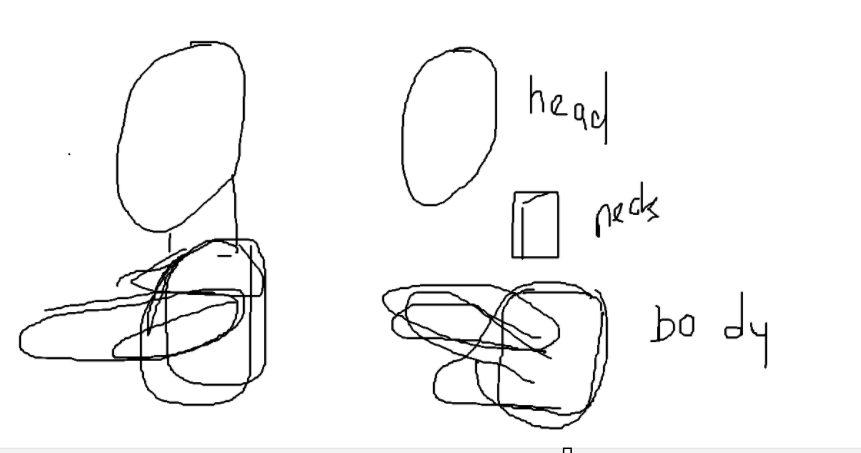

# Konsep: karakter dari part modular

Pertanyaan user (3 Nov 2026): model terdiri dari kepala, leher, dan badan yang terpisah. Bagaimana konsep membangunnya, supaya kalau ada referensi baru, Claude paham strukturnya dan **mengembangkan yang sudah ada, bukan membangun dari nol**?



Kiri: part dirakit dan saling masuk. Kanan: part yang sama dilepas: kepala, leher, badan (dengan lengan).

## Ide inti: "kit part"
Karakter = **rakitan part**. Tiap part punya 5 lapis. Yang disimpan adalah lapisan-lapisan ini, bukan mesh jadinya.

| Lapis | Isi | Contoh di kepala baseline (v7) |
|---|---|---|
| 1. **Landmark** | titik anatomi bernama | dagu, sudut rahang, ujung hidung, sudut mulut, alis, puncak kepala |
| 2. **Bentuk** | SDF + angka (proporsi) yang dihitung dari landmark | `head_sdf`: `JAW`, `NOSE`, `BROW`, lebar mulut 21 mm |
| 3. **Topologi** | template baris, kolom, dan loop | `COLS`, `FRONT_ROWS`, baris rahang, ring bibir, ring mata |
| 4. **Konektor** | cincin di ujung part, jumlah vertex dan posisinya standar | cincin bawah leher: 10 vertex (`NECK_COLS`) |
| 5. **Cek** | ukuran + baseline yang disetujui user | tertutup, simetri, sliver; `head_baseline.glb` |

### Konektor = kunci modular
Dua part bisa disambung kalau cincin konektornya cocok, misalnya sama-sama 10 vertex di sudut yang sama.
- kepala ↔ leher: cincin bawah rahang / atas leher
- leher ↔ badan: cincin pangkal leher / lubang leher di badan
- badan ↔ lengan: lubang bahu (badan F2 sudah memakai lubang 8 titik)

Karena konektornya standar, kepala versi lain (wanita, zombie, gemuk) tetap pas di badan yang sama. Ini sama dengan prinsip **satu topologi, banyak parameter** di [roadmap §2–3](../docs/10-roadmap-lowpoly.md).

## Dua cara menyambung (sesuai dua sketsa)
| | A. Tumpuk (sketsa kiri) | B. Jahit (sketsa kanan + konektor) |
|---|---|---|
| Cara | part terpisah saling masuk, tidak disambung | part dibuat terpisah, lalu cincin konektor dijahit (bridge) jadi satu mesh tertutup |
| Kelebihan | cepat, ganti part tinggal tukar | tidak ada celah saat bergerak, tidak ada poligon tersembunyi |
| Kekurangan | sambungan terlihat saat di-rig dan menekuk; ada poligon tersembunyi di dalam | konektor harus disepakati dulu |
| Cocok untuk | aksesori: rambut, topi, alis, mata | kulit karakter yang di-rig |

**Usulan**: bangun dan simpan per part (modular), lalu **jahit saat ekspor** untuk kulit karakter. Cara tumpuk dipakai untuk aksesori. Badan F2 di Three.js sudah memakai prinsip jahit (satu jaring tertutup).

## Alur saat ada referensi baru
1. **Baca struktur**: tentukan part apa saja yang ada (kepala, leher, badan, lengan, aksesori) dan cocokkan dengan library.
2. **Tandai landmark** di gambar referensi: depan dan samping, ortografis kalau ada.
3. **Isi spec** (file JSON): pilih varian part, ubah parameter dari landmark.
4. **Bangun**: generator membaca spec dan merakit part lewat konektor.
5. **Bandingkan** dengan referensi (render sudut sama, siluet) lalu ubah parameter. Kalau referensi punya fitur yang belum ada (misalnya telinga runcing atau helm), tambahkan **varian part baru** dengan konektor yang sama dan simpan ke library.

Contoh spec:
```json
{
  "name": "pria-lowpoly-01",
  "parts": [
    {"part": "head",  "variant": "baseline_v7", "params": {"jaw_width": 0.058, "mouth_w": 0.021}},
    {"part": "neck",  "variant": "basic",       "params": {"radius": 0.046, "length": 0.07}},
    {"part": "torso", "variant": "f2_male",     "params": {"shoulder": 1.0, "girth": 1.0}}
  ],
  "join": "stitch"
}
```

## Susunan file yang diusulkan
```
tools/blender/parts/      head.py, neck.py, torso.py, arm.py   (satu modul per part: landmark, bentuk, topologi, konektor)
tools/blender/parts/connectors.py   standar cincin + fungsi jahit
tools/blender/assemble.py           baca spec, rakit, cek, render
specs/*.json                        satu file per karakter
notes/parts/<part>.md               kartu part: landmark, parameter, konektor, baseline, riwayat
```

## Langkah pertama yang diusulkan
1. Jadikan kepala v7 part `head` dengan konektor bawah (cincin leher atas).
2. Buat part `neck`: tabung template, konektor atas dan bawah.
3. Part `torso`: bawa konsep badan F2 (sudah ada di Three.js) ke Blender, atau sebaliknya. **Perlu diputuskan**: pipeline utama di Blender (Python) atau Three.js (TypeScript).
4. `assemble.py` + satu spec, lalu jahit dan cek tertutup.
5. Uji dengan referensi baru: yang berubah hanya spec dan parameter.

## Keputusan (user, 3 Nov 2026)
- **Cara sambung: jahit kulit, tumpuk aksesori.** Kepala, leher, dan badan dijahit jadi satu mesh tertutup lewat cincin konektor. Telinga, alis, rambut, dan baju ditumpuk.
- **Cincin leher = 10 titik**, sama dengan kepala baseline (`NECK_COLS`), sehingga kepala tidak diubah. Badan menambah titik sendiri di bawah leher.
- **Pipeline utama: Blender (Python).** Badan F2 di Three.js hanya dipakai sebagai referensi bentuk.

## Status part (3 Nov 2026)
- Kepala template v7 + telinga v13 (disetujui) + hidung planes v2: [[parts/hidung]].
- Badan quad v1: konektor leher 10 titik dipakai langsung (kolom badan = kolom leher); lengan dan kaki = cincin 8
  yang tumbuh dari lubang/loop di badan: [[parts/badan-quad]]. Aksesori (baju, rambut) belum.
