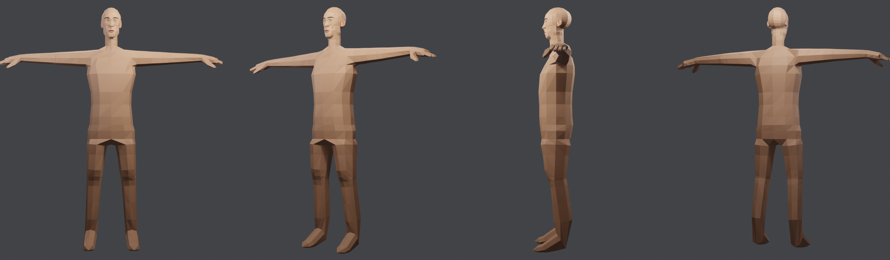
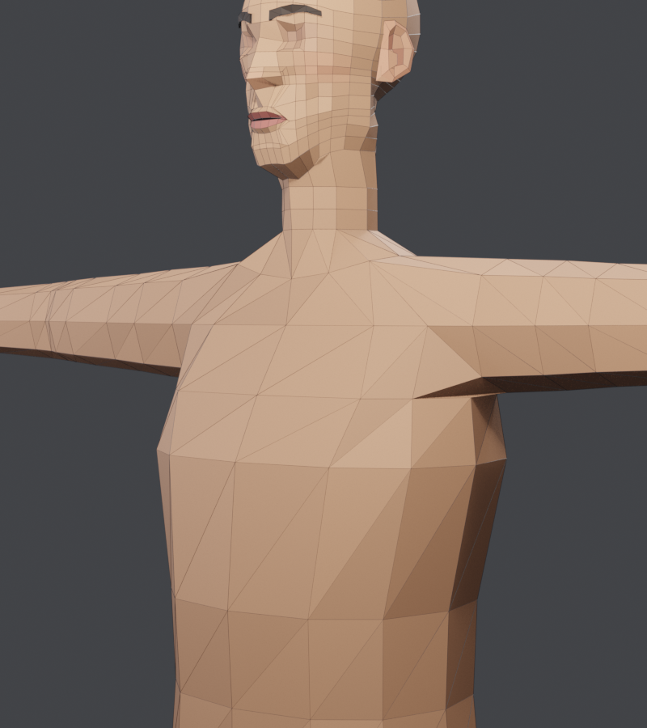
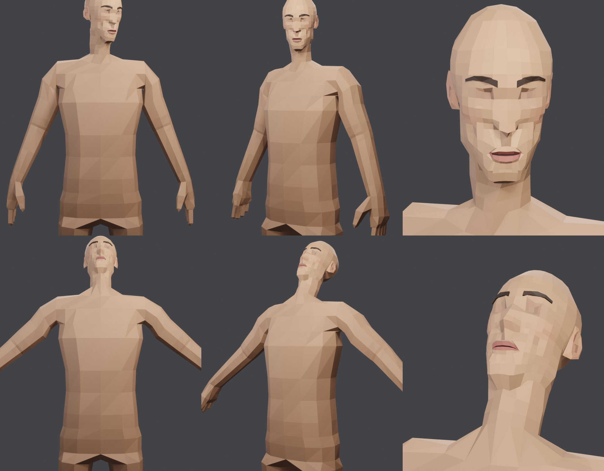

# Kartu part: badan F2 + kepala template

> **Diganti (3 Nov 2026)**: topologi badan dibangun ulang jadi quad bersih di [[badan-quad]]. F2 tetap dipakai sebagai cetakan bentuk dan bobot rig.

Keputusan user (3 Nov 2026): **pakai badan awal (F2) dan sambungkan dengan kepala baru**, bukan membangun torso dari nol ([torso Blender](torso.md) jadi cadangan). Ini sesuai prinsip [part modular](../konsep-part-modular.md): kembangkan yang sudah ada.

## Apa itu F2
`src/zombie/lowbody/body.ts` (Three.js), dikerjakan sebelum vault ini ada. Detail: [roadmap §7–11](../../docs/10-roadmap-lowpoly.md).
- Satu mesh tertutup seluruh badan: torso cincin 12, lengan dari lubang 8 titik, tangan dengan 4 jari + jempol, kaki dari pinggul dibelah, telapak.
- Rig 73 tulang (63 + helper bahu, siku, lutut, twist), bobot eksplisit per cincin. Baterai pose (jongkok, jalan, angkat tangan) tidak robek.
- Bentuk dari 18 karakter referensi: siluet IoU 0.91 pria, 0.87 wanita. Ada 5 slider (tinggi, bahu, pinggul, berat, otot).
- Kelemahan: kepala F6 kasar (cincin 24 kolom bergaris, hidung blok, dagu menggantung). Ini yang diganti.

## Cara rakit (`tools/blender/f2_assemble.py`)
1. **Ekspor dari Three.js tanpa browser**: `tools/f2/export_f2.ts` dibundel dengan esbuild (sudah ada bersama vite) lalu dijalankan di Node. Hasilnya JSON berisi titik, segitiga, bobot (tulang, nilai), dan tulang (nama, induk, pangkal, ujung). `body.ts` tidak diubah.
2. Three.js dan kepala kita memakai **sumbu yang sama** (x kiri karakter, y atas, z depan). Semua dipindah ke koordinat kepala (mata y = 0): `y kepala = y dunia − 1.6784`.
3. Kepala lama F2 (371 titik) dan **cincin leher F2** (12 titik, y 1.5064 m) dihapus. Cincin atas bahu F2 (12) jadi tepi terbuka.
4. Cincin leher kepala baru (10, y −0.172) diletakkan di ketinggian cincin leher F2 lama. Tutup leher kepala dihapus, lalu **pita segitiga 10 → 12** (22 tris) dijahit ke cincin atas bahu. Pita dibuat di setengah kanan lalu dicerminkan.
5. Bobot kepala: Head 1 di atas rahang, lalu bercampur ke Neck di baris leher (−0.132: 0.85, −0.153: 0.6, −0.172: 0.45), mendekati bobot cincin leher F2 lama (Neck 0.5 / Head 0.5). Telinga dan alis: Head 1.
6. Armature dibangun dari tulang JSON. Semua mesh di-parent dengan modifier Armature.

## Hasil v1
- **2352 segitiga** (kepala 914 + badan ±1416 + pita 22), **tertutup, simetri sempurna** (0 titik tanpa pasangan), 73 tulang.
- Uji pose (`tools/blender/pose_test.py`): kepala menoleh 30°, leher menunduk dan mendongak, lengan turun. Kulit ikut tanpa robek, telinga dan alis ikut kepala.
- Sisa: celah gelap kecil di ketiak saat lengan turun (masalah lama F2, lihat roadmap F3); warna badan belum dipisah per area.

## Perbedaan
| | Torso Blender (v2) | Badan F2 + kepala baru |
|---|---|---|
| Isi | leher bawah sampai pinggul | badan lengkap: lengan, tangan, jari, kaki, telapak |
| Lengan, kaki | belum ada (tutup sementara) | ada |
| Rig | belum ada | 73 tulang + bobot, sudah diuji pose |
| Bentuk | 8 cincin dari refBody, ditebak tangan | dicocokkan ke 18 referensi (IoU 0.91), ada slider |
| Segitiga | 264 (torso saja) | ±1416 (seluruh badan) |
| Pekerjaan sisa | lengan, kaki, tangan, rig dari nol | hanya rapikan sambungan dan warna |

| | Kepala lama F6 | Kepala template baru |
|---|---|---|
| Topologi | 24 kolom × 14 baris, bergaris horizontal | kolom/baris fitur, loop mata, mulut, nasolabial, rahang |
| Wajah | hidung blok, mulut warna saja | bibir atas/bawah, celah mulut, ujung hidung, rongga mata |
| Telinga | daun pipih | telinga trace v13 (rim, mangkuk, tragus) |
| Segitiga | ±880 | 914 + telinga 176 + alis 72 |

## Pelajaran
- **Cek dulu apa yang sudah ada sebelum membangun part.** Torso Blender memakan dua versi, padahal badan F2 yang lengkap dan sudah di-rig sudah ada.
- **Ekspor Three.js ke Blender lewat JSON topologi** (bukan GLB) mempertahankan titik bersama, bobot, dan nama tulang dengan pasti.
- **Konektor beda jumlah titik** (10 → 12) cukup dijahit dengan pita segitiga zip per sudut. Kerjakan di setengah sisi lalu cerminkan supaya tetap simetris.
- Cincin leher lama F2 ikut dihapus. Leher kepala baru sudah 5 cm, jadi kalau cincin itu dipakai, leher akan terlalu panjang.

## Berikutnya
- Penilaian user.
- Warna per area badan (kulit, celana/baju) dan perbaikan celah ketiak.
- Versi wanita (`node tools/f2/out/export_f2.mjs 1 ...`) dengan kepala template yang diberi parameter feminin.
