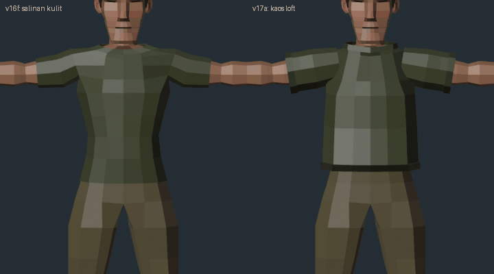

# Kartu part: kaos loft (survivor v17a)

Masukan user: baju v13–v16f "bukan baju, cuma nempel". Penyebab: [baju modular](baju.md) = face kulit disalin, didorong keluar 7–13 mm, ditebalkan. Bentuknya sama persis dengan badan (lekuk pinggang, dada), tanpa tepi. Dari jauh terlihat seperti cat.

Kode: `tools/blender/garment_loft.py` (fungsi `shirt`), dipanggil `clothes.py --set loft`. Celana dan bot masih cara lama.

Atas/kiri v16f (salinan kulit), kanan v17a (kaos loft). Diam: `turn_v16f_v17a_still.png`.

## Kenapa baju terlihat seperti baju
1. **Siluet sendiri**: kain jatuh lurus dari titik terlebar, tidak masuk ke cekungan.
2. **Kelonggaran tidak rata**: rapat di bahu, longgar di perut dan ujung lengan.
3. **Tepi tebal**: rib kerah, kelim bawah, manset lengan. Tangga kecil (ledge) keluar dari permukaan kaos = tanda lapisan kain paling kuat.
4. **Tumpukan**: kaos menutupi pinggang celana.
5. Topologi sendiri: cincin di tepi dan sendi saja.

## Cara bangun
- **Badan kaos**: loft 12 kolom (sudut polar dari sumbu badan, 0 = depan). Tiap cincin: radius dari **ray cast** keluar dari sumbu ke face badan (`part` trunk + crotch).
- **Drape**: di bawah dada (`chest_z` 1.245), radius = radius badan **terbesar** dari dada sampai cincin itu + kelonggaran. Kain tidak mengecil di pinggang.
- Kelonggaran: kerah 15 mm, bahu 7, dada 12, perut 20, kelim 26 (+6 tangga).
- **Kerah**: ikut baris leher badan (baris 0, kurva polar sudut → z, r). Leher condong ke depan, jadi radius juga diambil dari ray ke face leher sampai puncak rib (tanpa itu kerah depan masuk leher 5 mm).
- **Bahu**: baris trapezius (baris 1) + ray; interpolasi antar titik baris = tali busur di dalam kulit, ray menangkap tonjolan.
- **Ketiak**: ray lewat lubang lengan meleset, jadi interpolasi antara garis bahu dan dada.
- **Lengan**: tabung 8 kolom sendiri di sumbu tulang `upper_arm`, drape keluar (melebar ke ujung), manset dengan tangga. **Pangkal masuk ke dalam badan kaos** (x 0.12, skala 0.85): tumpang tanpa sambungan, lengan keluar dari dinding samping seperti set-in sleeve. Pangkal di x 0.165 menyisakan kulit bahu terlihat.
- Dinding 4 mm (Solidify). Normal dibalik per **cangkang**, bukan per face (face tangga normalnya searah sumbu, uji per face acak).
- **Bobot**: 6 vertex badan terdekat, inverse distance, maks 4 tulang, dinormalkan. Lengan baju (selain pangkal) hanya dari kulit lengan: bobot dada di cap membuat kulit lengan tembus saat tangan diangkat. Bobot "kulit tepat di bawah" (3 vertex) malah membuat kain terlipat (flip/collapse di semua pose).
- `src` (cek tembus E4): vertex badan terdekat yang **di bawah** titik (normalnya mengarah ke titik). Vertex terdekat biasa bisa sudut pangkal leher yang normalnya ke atas: kerah dianggap tembus padahal tidak. Pangkal lengan (tersembunyi) `src` −1.
- Kulit di bawah kaos dibuang, kecuali yang menyentuh kelim dan manset. Pita pangkal leher ikut dibuang: rib kerah berdiri di atasnya.

## Hasil
| | v16f | v17a |
|---|---|---|
| kaos tris | (salinan) | 864 |
| total tris / glb | 3124 / 366 KB | 3440 / 400 KB |
| E1 | 55/55 | 56/56 |
| E4 | siku 120° | siku 120° (sama) |
| kain tembus | 0 | arms_up 2 (dinding dalam, 0.3 mm), torso 3 (kerah belakang saat kepala menoleh 60°, 1–2.6 mm) |

## Pelajaran
- Baju dari salinan kulit = kulit dicat. Baju perlu **bentuk sendiri**: drape dari titik terlebar + kelonggaran + tepi bertangga.
- Ray cast dari sumbu lebih tepat daripada interpolasi titik baris (tali busur masuk kulit).
- Bobot baju longgar: halus (banyak tetangga) lebih aman daripada lokal; bagian yang menempel di satu tulang (lengan) ambil dari kulit tulang itu saja.

## Berikutnya
- Penilaian user. Celana kargo dengan cara loft (lurus dari pantat, saku tempel, kelim masuk bot). Kerah: bobot leher sedikit lebih besar.
