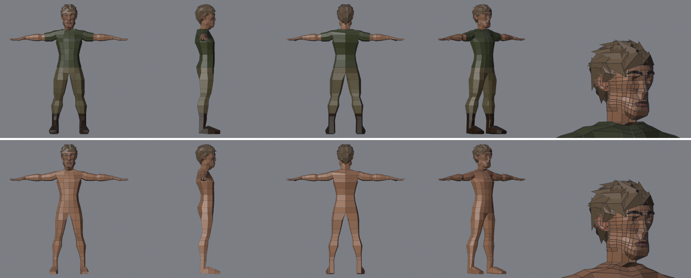
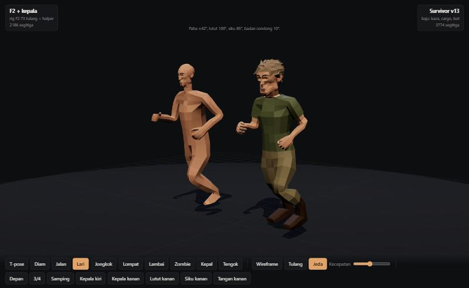

# Kartu part: baju modular (survivor v13)

Setelan dasar: **kaos** (hijau zaitun), **celana cargo** (khaki, kantong paha), **sepatu bot** (coklat, sol gelap).
Kode: `tools/blender/clothes.py` (set `basic`). Hasil: `output/ref/survivor/survivor_v13_dressed.blend`,
glb `output/qa/survivor_v13_dressed.glb` (442 KB, 3774 tris), dipakai viewer gerak (`?pair=survivor`).

```
ref_body.py (RB_TAG=ref_body_v13base) -> head_paint -> hair -> survivor_v13.blend
rig_game.py  -> survivor_v13_rig.blend
clothes.py   -> survivor_v13_dressed.blend      (--keep-skin: kulit di bawah baju tidak dibuang)
```


Atas v13 berbaju, bawah v12 tanpa baju.


## Cara (Rozi: duplikat face + Solidify)
1. `ref_body.py` sekarang menulis label per face: `part` (1 badan, 2 leher, 3 lengan, 4 telapak, 5 jari, 6 jempol,
   7 kaki, 8 selangkangan) dan `ring` (pita: badan 0–9 dari dasar leher ke selangkangan, lengan 0–7 dari pangkal ke
   pergelangan, kaki 0–13 dari selangkangan ke ujung kaki; 10–13 = telapak).
2. Tiap baju = salinan face badan yang dipilih lewat label, didorong keluar sepanjang normal face yang dipilih saja
   (di tepi baju normal tidak miring ke kulit yang terbuka).
3. Dinding 4 mm (Solidify ke dalam, rim tertutup, **tanpa even offset**).
4. Bobot disalin dari titik badan yang sama, jadi baju menekuk persis seperti kulit di bawahnya.
5. **Kulit yang tertutup dibuang** (314 face). Pita tepat di bawah bukaan (kerah, ujung lengan) tetap, supaya tidak
   ada lubang terlihat. Badan diberi `qa_open_ok`: tepinya ada di dalam baju.

| Baju | Face badan | Offset | Tris |
|---|---|---|---|
| Kaos | badan 0–8, lengan 0–1 | 12 mm (lengan 10) | 528 |
| Cargo | badan 7–9, selangkangan, kaki 0–8 | pinggang 7, paha/betis 13, lutut 9, ujung 6 mm; kantong +12 mm di sisi luar paha pita 1–2 | 756 |
| Bot | kaki 7–13 | 12 mm, sol tidak di bawah lantai | 440 |

Badan tinggal 1482 tris (dari 2110). Total 3774.

## QA
- E1 49/49 (badan terbuka disengaja = INFO, rim dinding baju tidak dihitung sliver: `qa_wall`).
- E4 baru: **kulit tembus baju** (`src` = titik badan asal; celah sepanjang normal badan saat dipose < 0) = 0 di
  semua pose. Lipatan baju sendiri juga diukur. Sisa gagal hanya siku 120° (kulit lengan bawah, bukan baju).

## Riwayat
| Masalah | Sebab | Perbaikan |
|---|---|---|
| dinding dalam tembus 12 mm di selangkangan dan tumit | Solidify even offset menebalkan lipatan tajam | even offset mati, `thickness_clamp` 0.5 |
| lutut tembus celana saat jongkok (−4.8 mm) | lutut 120° | kulit di bawah baju dibuang |
| celana terlipat di sisi luar lutut saat jongkok | dinding longgar 13 mm memperbesar kempis sendi | pita lutut 9 mm |
| sliver 2.25 % | rim dinding 4 mm | dikenali sebagai rim (`qa_wall`) |

## Pelajaran
- **Baju dari face badan + bobot badan** = tidak perlu rig ulang, tidak tembus selama offset > 0.
- **Buang kulit di bawah baju**: di game kulit tertutup hanya menambah tris dan bisa tembus di pose ekstrem.
- **Longgar di sendi = lipatan**: baju longgar boleh di paha/betis, harus pas di lutut/siku.
- Generator sebaiknya menulis **label part per face**; tanpa itu, memilih area baju harus menebak dari posisi.

## Berikutnya
- Variasi set (jaket, celana pendek, sepatu kets) di `SETS`.
- Detail: kerah, ikat pinggang, tali bot (warna per face dulu).
- Warna kulit tangan/kepala sudah ada; tekstur baju (UV) kalau dibutuhkan.
