# Kartu part: telinga (ear)

Kartu part pertama sesuai [Konsep part modular](../konsep-part-modular.md). Kode: `EAR_TRACE`, `EAR_FACES`, `ear_points`, `ear_mesh`, `ears` di `tools/blender/head_template.py`. Warna: `EAR_ZONE` di `tools/blender/head_paint.py`. Render khusus telinga: `tools/blender/ear_view.py` (tampak lurus, 3/4, depan + wire JSON). Perbandingan dengan referensi: `python tools/blender/ear_compare.py v13 <gambar>`.

## Referensi gaya (pilihan user, 3 Nov 2026)
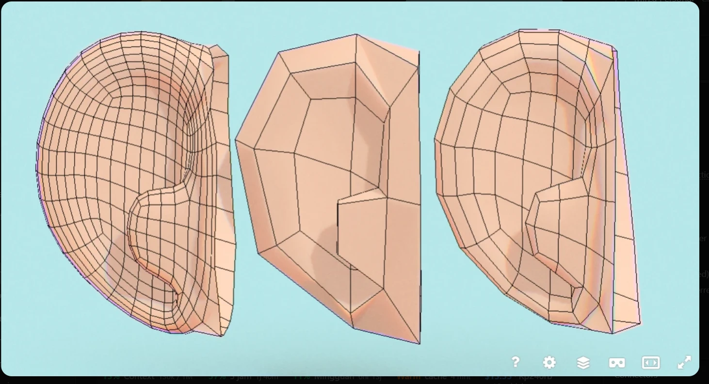

User memilih **yang tengah**: low-poly, simpel, telinga jelas terbaca. Ciri bentuknya:
- Garis luar **setengah hati**: tepi depan lurus menempel ke kepala, puncak bulat lebar, tepi belakang turun miring ke **ujung cuping lancip** di bawah depan.
- Di dalam: **rim** (helix) tebal mengikuti garis luar, **dataran lebar** (antihelix), **mangkuk** (concha) kecil dekat pangkal depan, lalu **tangga/takik** di bawah mangkuk dan **blok tragus** yang menonjol.
- **Bukan cincin konsentris.** Corong lingkaran dengan tonjolan di depan (v10) ditolak.

## v13: trace titik per titik (sekarang)
User minta: "TRAYCING THIS IMAGE".

Cara trace:
1. Perbesar gambar 3× (sekitar tragus 5×) dengan grid koordinat piksel, lalu baca tiap titik sudut.
2. Tulis `EAR_TRACE`: nama → (x px, y px, tinggi n mm). Skala 0.1287 mm/px (443 px = tinggi 57 mm), u dilebarkan 1.15× karena gambar adalah tampak 3/4.
3. Tulis `EAR_FACES`: daftar muka (n-gon boleh) dari garis wire. **Garis putus-putus = edge tersembunyi** di balik dinding mangkuk, tidak dibuat.
4. Cek: gambar ulang edge trace di atas gambar asli (merah). Harus menempel di garis aslinya.
5. Kedalaman n ditebak dari bayangan di gambar: daerah gelap = cekung, muka terang rata = menonjol.

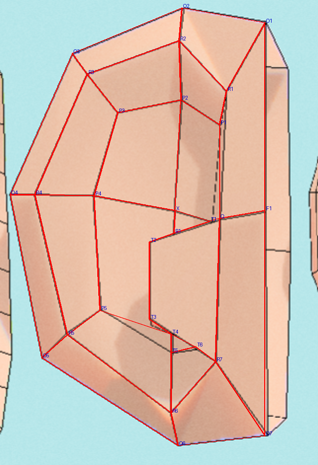

29 titik depan, 20 muka depan (tragus 8 sisi, cekungan bawah 7 sisi), 88 tris per telinga, tertutup.
**N-gon tidak dipecah.** Dengan flat shading, satu n-gon dapat satu normal, sehingga tragus dan dataran terlihat sebagai satu bidang seperti referensi. Kalau dipecah jadi segitiga, muncul garis diagonal dan bayangan bertingkat.

Perbandingan (kiri referensi; kanan render dicerminkan, tampak lurus, 3/4, depan):
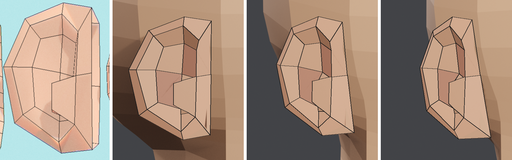
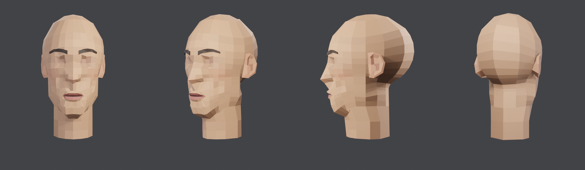

## Anatomi (luar ke dalam)
| Bagian | Apa | Di mesh v11 |
|---|---|---|
| **Helix** | bibir luar yang tebal | cincin 0 (tepi luar) + cincin 1 (tepi dalam atas rim) |
| **Dinding rim** | turunan dari rim ke dataran | cincin 1 → cincin 2 (kaki dinding) |
| **Antihelix** | dataran lebar di dalam | pita cincin 2 → cincin 3 |
| **Concha** | mangkuk dekat pangkal depan | cincin 3 (bibir mangkuk) → cincin 4 (dasar) → titik lubang |
| **Tragus** | blok menonjol di depan bawah mangkuk | titik 8 cincin 3 dan 4 (n 4.8 / 2.8 mm) |
| **Takik** | tangga di antara mangkuk dan tragus | titik 9 cincin 3 rendah (1.2 mm) di sebelah tragus |
| **Cuping** | bawah, padat, lancip | titik 7 semua cincin, tanpa dinding |

## Landmark dan parameter
- Tiap cincin = **10 titik (u, v, n) mm ditulis tangan**, urutan sama: 0 pangkal atas, 1 atas depan, 2 puncak, 3 atas belakang, 4 belakang atas, 5 belakang bawah, 6 cuping belakang, 7 ujung cuping, 8 pangkal bawah (tragus), 9 pangkal tengah.
- u = 0 di pangkal, negatif ke belakang (dikali `EAR_US` 1.35); v ke atas; n keluar dari kepala.
- Tinggi telinga 57 mm (v +29.5 sampai −27), lebar ±31 mm. Puncak setinggi alis, cuping setinggi bawah hidung.
- `EAR_ANGLE` 15°: bidang telinga diputar sehingga tepi belakang menjauh dari kepala (v9 memakai 30°, terlalu mekar).
- Penempatan ke kepala (dihitung dari SDF kepala):
  - `EAR_ROOT_SINK` 1.5 mm: pangkal masuk sedikit ke kulit.
  - **lift**: titik diangkat kalau tengkorak menonjol melewati bidang telinga (di atas telinga).
  - `EAR_FLOOR_MIN` 0.6 mm: titik depan selalu di luar kulit, supaya kulit kepala tidak tembus di mangkuk.

## Topologi
- 5 cincin depan × 10 titik + kipas ke lubang. Belakang: garis luar dikecilkan 2 kali + kipas yang masuk kepala.
- Mesh tertutup per telinga, 140 tris per telinga (v9: 160, v7: 36).
- Atribut muka `ear_zone`: 0 belakang, 1 rim (atas + dinding), 2 dataran, 3 dinding mangkuk, 4 lubang.

## Konektor
- **Tumpuk** (overlap): pangkal dan sisi belakang masuk ke kepala, tidak dijahit.
- Titik lem (v12): titik 0, 7, 8, 9 cincin 0 berada 1 mm di bawah kulit (cuping +1 mm). Cincin belakang kedua dan pusat belakang 3–5 mm di bawah kulit. Kedalaman titik-titik ini diukur dari kulit kepala, bukan dari bidang telinga. Posisi bidang dihitung dari permukaan SDF kepala, jadi kalau bentuk kepala berubah, telinga tetap menempel.

## Riwayat
| Versi | Cara | Hasil |
|---|---|---|
| v7 | ray shell dari pusat `ear_sdf` + decimate 36 tris | daun pipih tanpa cekungan |
| v8 | cincin konsentris dirancang, mangkuk di tengah | ada cekungan, tapi seperti papan target |
| v9 | garis luar C, mangkuk ke depan-bawah, tragus | cekungan ada, tapi terlalu halus dan ramai |
| v10 | 8 titik, teras rata + dinding curam, tetap konsentris | **ditolak**: corong lingkaran dengan tonjolan di depan |
| v11 | titik ditulis tangan dari referensi setengah hati, 5 cincin, bidang 15°, lift dari SDF | bentuk benar; **user: telinga menggantung, tidak menempel, dan tonjolan depan (tragus) tidak ada** |
| v12 | titik pangkal dan sisi belakang diukur dari kulit (`EAR_SKIN_PTS`, `EAR_SKIN_BACK`); tragus 8.5 mm dengan takik rendah di bawahnya | pangkal menyatu ke kulit; user minta detail persis gambar |
| **v13** | **trace titik dan muka langsung dari gambar**, n-gon utuh, lem kulit dari v12 | garis luar, rim, dataran, mangkuk, blok tragus dengan tangga sama dengan referensi; **disetujui user** |

v10 (ditolak):
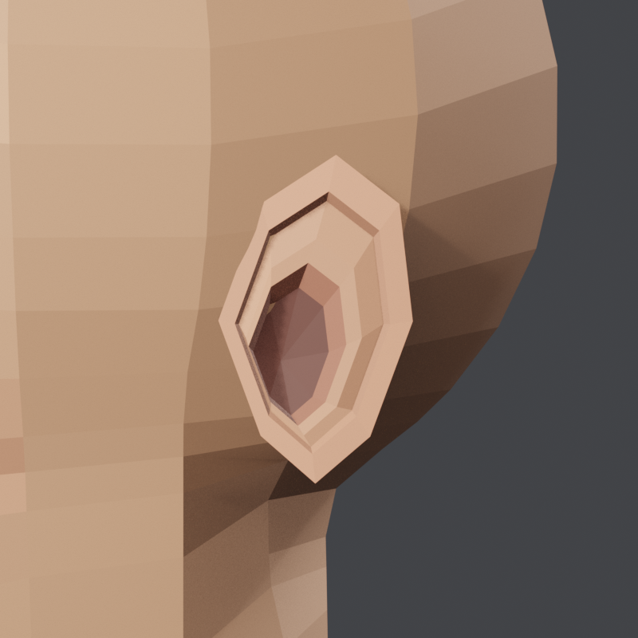

Feedback user untuk v11 (panah = tonjolan depan yang hilang):
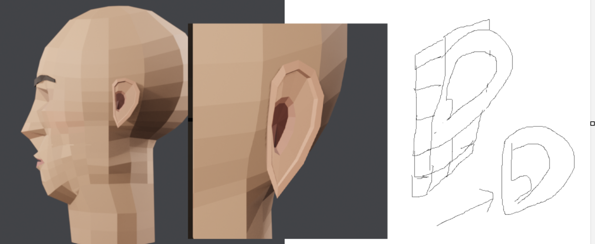

v12:
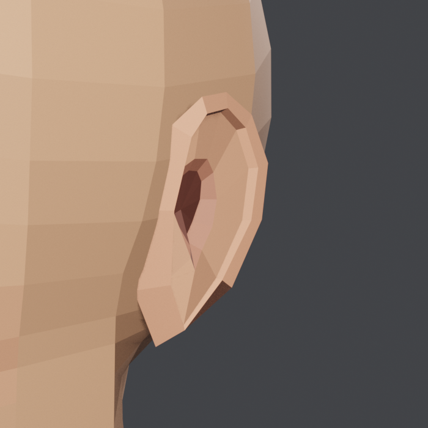
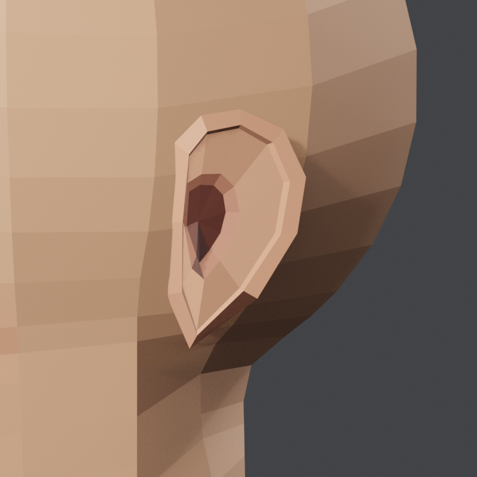
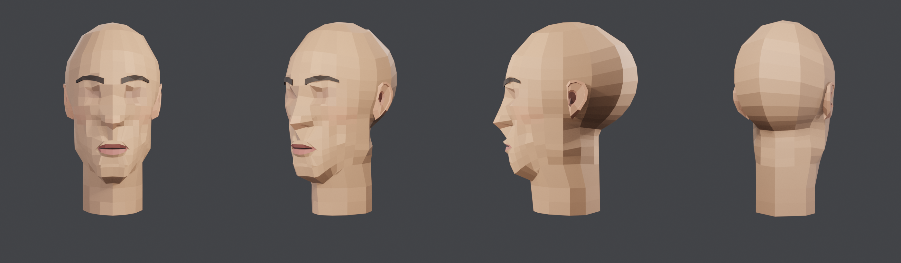

v11:
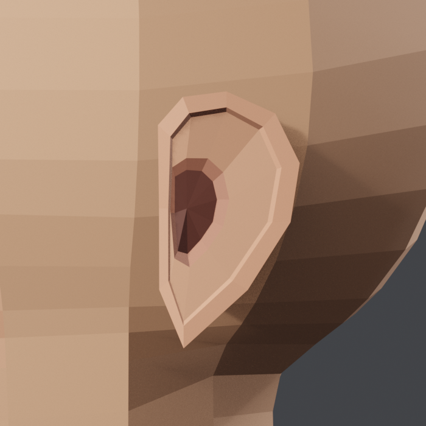
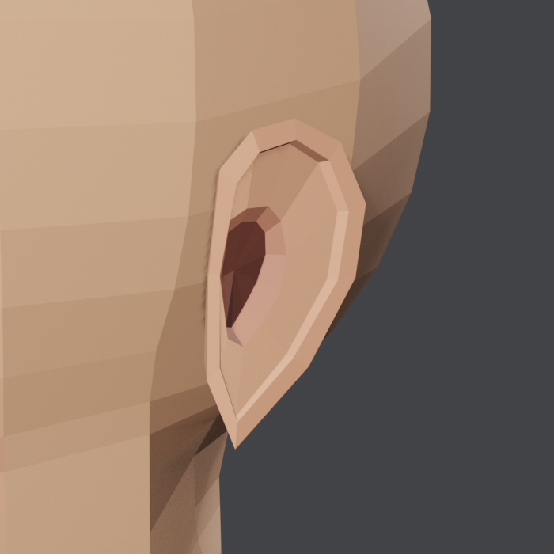
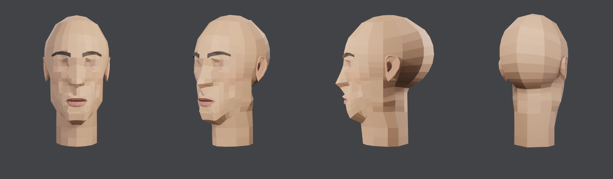

Lama (v7 sampai v9):
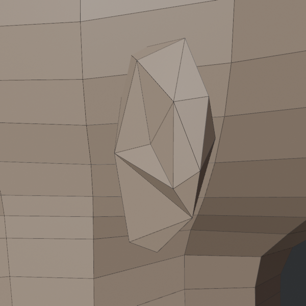
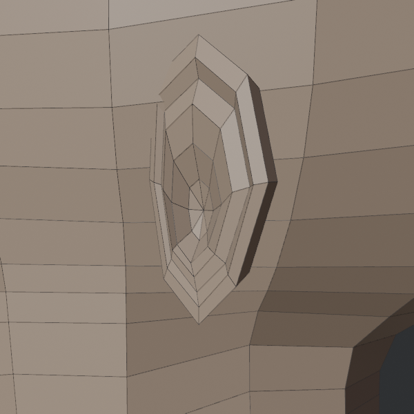
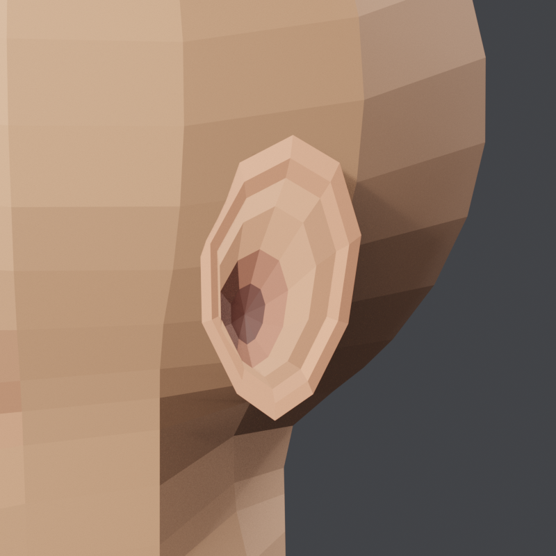

## Pelajaran
- **Kalau user memberi gambar wire, trace saja, jangan menebak anatomi.** v8 sampai v12 menebak bentuk dari deskripsi dan selalu meleset. Trace dengan grid piksel memberi layout yang sama dalam satu kali coba.
- **Overlay trace di atas gambar asli** sebelum membangun 3D: kesalahan baca titik langsung kelihatan.
- **N-gon + flat shading = bidang rata seperti referensi low-poly.** Pecah segitiga hanya saat ekspor.
- **Part tumpuk harus dilem ke kulit, bukan ke bidang.** Kalau kedalaman pangkal diukur dari bidang telinga, kepala yang melengkung membuat celah dan telinga terlihat menggantung. Ukur titik pangkal dan sisi belakang dari permukaan SDF kepala.
- **Tonjolan butuh lembah di sebelahnya.** Tragus setinggi 9 mm tidak terlihat karena titik di sekitarnya 8 mm, jadi hanya terbentuk lereng. Takik rendah (2 mm) di bawahnya membuat tragus jadi puncak.
- **Lihat part dari arah yang dihadapinya.** Tragus menghadap ke wajah, jadi perlu kamera `ear_front`.
- **Bentuk cekung tidak bisa diambil dengan sinar dari satu titik di dalam.** Telinga perlu tata letak yang dirancang.
- **Cincin yang diskalakan dari satu garis luar selalu terbaca sebagai corong atau target**, walaupun pusatnya digeser. Untuk telinga gaya low-poly: **tulis titik tiap cincin dengan tangan** dari gambar referensi, dengan urutan titik yang sama di semua cincin.
- **Cek tertanam dulu sebelum menilai bentuk.** Dua render pertama v11 terlihat seperti bulan sabit karena dua pertiga telinga ada di dalam kepala. Tengkorak di atas telinga menonjol melewati bidang datar. Ukur SDF tiap titik, lalu angkat titik yang tertanam.
- **Rim tegas butuh dua cincin**: tepi atas rim dan kaki dindingnya, jaraknya kecil tapi tingginya beda ±2 mm. Kalau hanya satu, rim melebur jadi lereng.
- **Render tegak lurus bidang part** (`ear_view.py`) untuk membandingkan dengan referensi. Kamera kepala 3/4 membuat telinga miring dan sulit dinilai.

## Penilaian user
- **3 Nov 2026: v13 DISETUJUI** ("i think sudah oke yang ini"). v13 menjadi baseline telinga: `EAR_TRACE` + `EAR_FACES` di `head_template.py`. Perubahan berikutnya dibandingkan dengan v13.

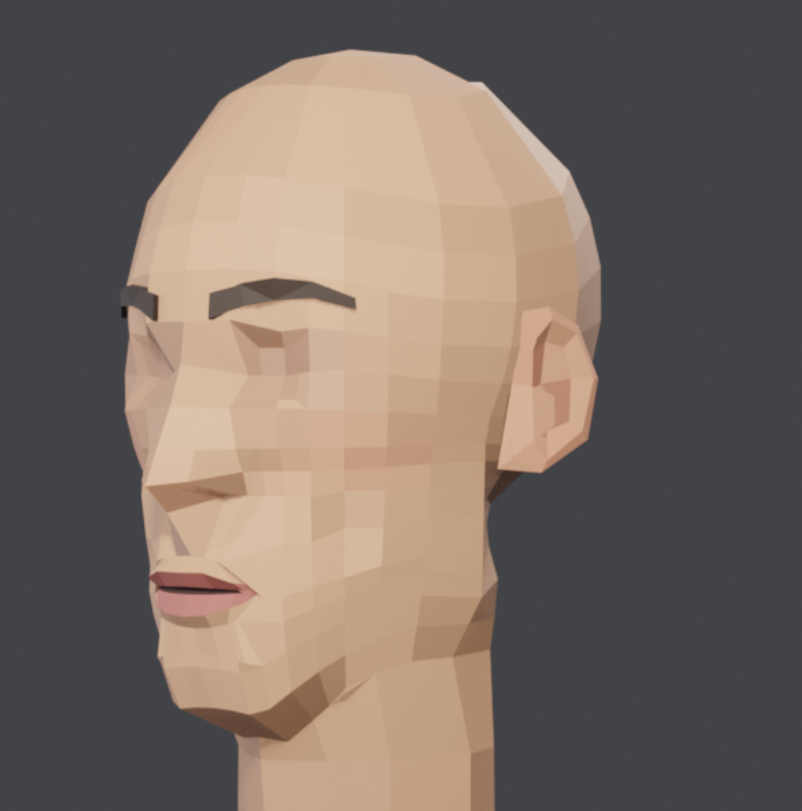

## Berikutnya
- Lipatan kecil gelap di pangkal bawah (dekat O7) karena titik lem mengikuti kulit; bisa dihaluskan.
- LOD rendah: buang cincin 2 (±100 tris per telinga).
