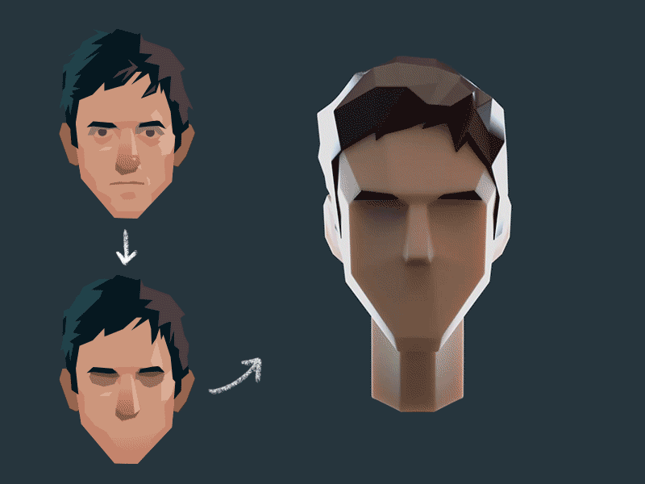
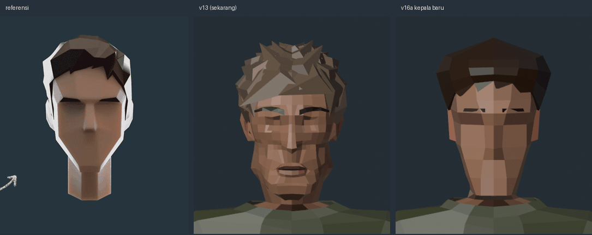
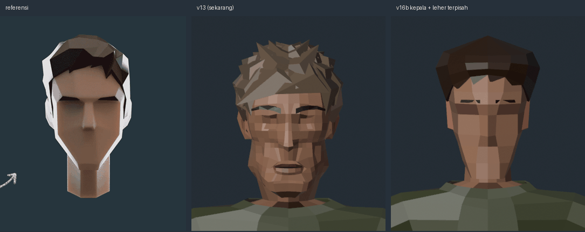
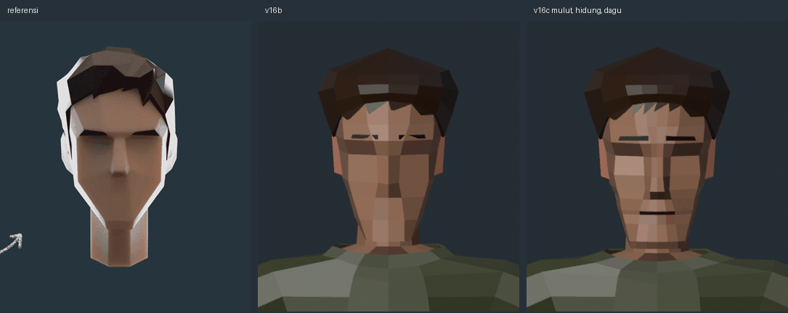
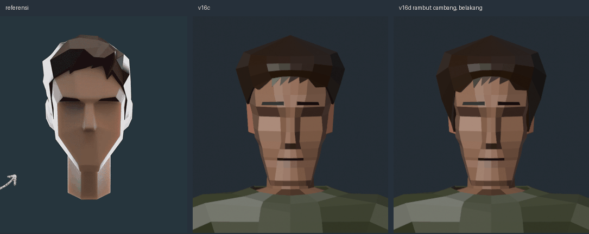
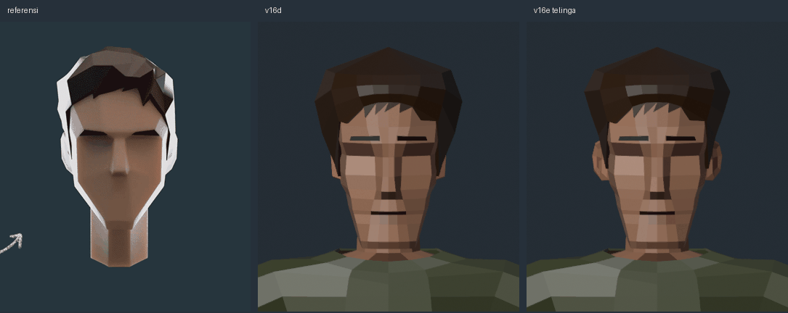
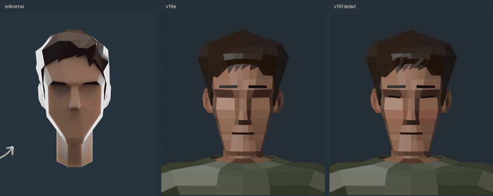

# Kartu part: kepala bidang besar (survivor v16f)

Pengganti kepala `head_masc_v1` (sculpt → banyak face kecil, rambut duri). Gaya dari GIF referensi user:

Kode: `tools/blender/head_planes.py` → `output/head-game/template/head_lp_v6.blend` (kepala 156 face + leher tusuk + telinga v13 + detail).
Rantai: `head_planes.py` → `ref_body.py` (RB_HEAD=head_lp_v6; v16e: v5, v16d: v4, v16c: v3, v16b: v2, v16a: v1) → `head_paint.py` → rig → baju. Langkah `hair_lowpoly.py` tidak dipakai (rambut sudah ada di template).

Kiri referensi, tengah v13, kanan v16a. Diam: `turn_v13_v16a_still.png`.

## Cara bangun
- **Satu loft 10 kolom**, sama dengan kolom leher badan (0, 22, 48, 90, 120, 180 + cermin). Tiap baris = 6 titik (x, z) di setengah kepala. Kepala langsung jadi tabung leher, tanpa segitiga peralihan.
- Kolom 22 = tepi hidung / sudut dalam mata, 48 = garis tulang pipi (sudut depan wajah), 90 = sisi kepala, 120 = sudut belakang.
- **Hidung**: kolom 0 maju di baris ujung hidung (baji).
- **Rahang baji**: kolom 90 turun di sepanjang tepi rahang, dari sudut rahang di bawah telinga (y −0.062) ke sudut dagu (y −0.12). Di bawahnya (kolom 90 → cincin leher) jadi bidang bawah rahang: garis miring di tampak samping.
- **Rongga mata**: face baris alis → mata, kolom 22–48, atribut `zone` = 1 → warna lebih gelap (`head_paint`).
- **Rambut helm**: 4 baris dari ubun-ubun ke garis rambut per kolom (dahi tinggi, di atas telinga, tengkuk). Tebal per baris 32 → 5 mm (volume di atas, rapat di tepi), depan +6 mm. Dinding dalam 2 mm masuk kulit, tepi ditutup quad. Poni = 4 gigi tertutup di segmen depan, miring ke kanan karakter.
- Kepala 0.92 lebih sempit dari template lama: tinggi, bukan bola.
- Telinga dan alis: lempeng sederhana. Tidak ada mulut (seperti referensi).

## v16b: kepala = bola, leher = tusuk
Masukan user: "bola yang ditusuk". Kepala dan leher dipisah:
- **`Head`**: kepala tertutup. Baris bawah kolom belakang (120, 180) punya tinggi sendiri (x, z, y): naik ke dasar tengkorak. Bawah rahang dan tengkorak ditutup dengan tutup yang sama seperti ubun-ubun. Kaku: 100 % tulang `head` (`rig_game.RIGID_HEAD`).
- **`Head_Main`** (kontrak lama `ref_body`): sekarang hanya tusuk leher. Tabung 10 titik dari dalam kepala (tutup di y −0.05) turun ke loop −0.132, lalu badan dijahit seperti biasa. Bobot leher dari badan.
- `ref_body.place_head` mengukur dari `Head` kalau ada, bukan dari tusuk.
- Hasil: dari samping garis bawah rahang dan tengkorak tegas, leher jelas batangnya sendiri. E1 50/50, E4 sama (siku 120° saja), menoleh bersih, 2748 tris, glb 323 KB.

## v16c: kedalaman, mulut, dagu, batang hidung
Masukan user: tambah kedalaman, mulut belum ada, dagu terlalu lancip / siku, tulang hidung persegi panjang tidak terlihat.
Kepala sudah objek sendiri, jadi kolomnya tidak terikat 10 kolom leher lagi: `HCOLS = [0, 10, 22, 48, 90, 120, 180]` (12 per cincin).
- **Batang hidung**: kolom baru 10 (x 8–10 mm). Kolom 0 dan 10 maju sama jauh dari mata sampai ujung hidung: depan hidung jadi bidang datar persegi panjang, sisi hidung = kolom 10 → 22.
- **Kedalaman**: tulang alis maju (kolom 22 z 0.100), rongga mata 19 mm di belakangnya; baris tulang pipi baru (y −0.028) dengan sudut pipi maju.
- **Mulut**: baris bibir atas (−0.073) dan dasar mulut (−0.078), pita 5 mm masuk 6 mm, `zone` 2 gelap; bibir bawah `zone` 3. Lebar = kolom 22 (48 mm).
- **Dagu**: depan datar lebar (kolom 0–22, 56 mm) + satu baris bevel di bawahnya (−0.122, mundur 1 cm). Tidak lancip lagi.
- Lebar kepala (0.92 → 0.96) sekarang berubah halus per tinggi, bukan loncat di satu baris.
- Hasil: E1 50/50, E4 sama (siku 120° saja), 2920 tris, glb 342 KB. IoU kepala depan 0.820 → 0.838, samping 0.827 → 0.838.

## v16d: rambut menutup sisi dan belakang
Dibanding GIF: rambut v16c berhenti di atas telinga, kulit terlihat di belakang telinga dan tengkuk.
- Garis rambut per kolom diturunkan: sisi (90) −0.020 (menutup atas telinga), belakang 120 / 180 ke −0.050 / −0.060 (dasar tengkorak).
- `TEETH` (pengganti `FRINGE`): titik rambut di segmen tepi mana saja, dengan posisi di sepanjang segmen. Ujungnya diproyeksikan ke kulit (tidak melayang). Poni seperti dulu, **cambang** (48 → 90, posisi 0.8, turun 27 mm, di depan telinga), **tengkuk** (120 → 180, turun 10 mm).
- Tebal tambahan kolom belakang (`HAIR_BACK`, 12 mm di baris tengah): tonjolan di atas dasar tengkorak.
- Hasil: E1 50/50 (sliver 0.0174, sekarang lolos), E4 sama (siku 120° saja), 2936 tris, glb 344 KB. IoU kepala depan 0.838 → 0.848, samping 0.838 → 0.847.

## v16e: telinga
Telinga v13 yang dulu disetujui ([telinga](ear.md): trace setengah hati, n-gon utuh) dipakai ulang: data `EAR_TRACE` / `EAR_FACES` dari `head_template.py`, penempatan baru di `head_planes.ears`.
- Kulit dicari dengan **ray cast** ke kepala bidang (BVHTree dari poligon `Head`), bukan SDF kepala lama.
- **Pangkal dikunci** di `EAR_ROOT_Z` −0.004 (tepat di belakang tepi rahang). Dorongan ke kulit sepanjang normal yang miring ikut menggeser telinga ke depan (pertama kali pangkal berada di pipi, z +0.021, dan telinga rata dengan pipi), jadi posisi diulang: dorong → geser pangkal ke target → dorong lagi.
- **Mekar 28°** (`EAR_FLARE`; di kepala lama 15°): sisi kepala bidang lebih rata, telinga harus berdiri lebih jauh supaya terlihat dari depan dan belakang. Skala 0.92.
- Rambut: garis rambut kolom 90 naik ke 0.016 (lengkung di atas telinga), sudut belakang (120) ke −0.012; cambang turun 46 mm di depan telinga. Bagian atas telinga masuk ke rambut seperti di GIF.
- Hasil (berbaju): E1 50/50, E4 sama (siku 120° saja), 3088 tris, glb 360 KB. IoU kepala depan 0.852, samping 0.845. Tanpa baju, gerbang sliver gagal tipis (0.0261 > 0.02): n-gon dan segitiga telinga. Dengan baju lolos.

## v16f: detail kecil tanpa ubah bentuk
User: struktur sudah bagus, perdetail sedikit, jangan banyak perubahan. Geometri kepala tidak diubah; detail lewat warna zona dan objek kecil:
- **Kelopak mata**: objek `Eyes`, lempeng tipis gelap di rongga mata (kolom 22–48, baris mata), ujung luar sedikit naik. Kaku di tulang kepala (`RIGID_HEAD`).
- **Lubang hidung**: `zone` 4 di bawah hidung samping septum. Gelap penuh (0.45) terlihat seperti kotak hitam dari depan; 0.60 cukup.
- **Rona hangat**: `zone` 5 di ujung hidung, septum, depan pipi.
- **Helai rambut**: 3 baji pipih (`LOCKS`) di depan helm, ujung ke tepi dan ke kanan karakter. Percobaan 5 helai berderet seperti sisir; baji tinggi sempit seperti staples.
- Hasil: E1 55/55 (berbaju), E4 sama (siku 120° saja), 3124 tris, glb 366 KB. Siluet tidak berubah (IoU kepala 0.852 / 0.844).

## Hasil v16a (kepala + leher satu loft)
| | v13 | v16a |
|---|---|---|
| triangle total | 3774 | 2732 |
| E1 | 49/49 | 45/45 (objek lebih sedikit) |
| E4 | siku 120° gagal | siku 120° gagal, menoleh bersih |
| IoU kepala depan / samping | 0.822 / 0.869 | 0.820 / 0.819 |

IoU samping turun: lembar survivor punya rambut jabrik tinggi, kepala baru ikut gaya GIF. Gaya dipilih user, bukan IoU.

## Pelajaran
- **"Kotak-kotak" = banyak face kecil**, bukan warna. Template sculpt + decimate memberi ratusan face; tiap face kena cahaya beda. Kepala gaya ini dibangun langsung dari sedikit bidang.
- Mengubah template lama (taper rahang v15a: rahang 65 → 49 mm per sisi) tidak cukup; bentuk berubah tapi faset kecil tetap.
- Atribut warna domain FACE bukan `color_attributes` (hanya POINT / CORNER): cari lewat `me.attributes.get("Col")`, kalau tidak `color_attributes.new` membuat `Col.001` dan material membaca yang lama (badan jadi putih).
- Nama skrip baru: cek dulu tidak menimpa modul lama (`head_lowpoly.py` dipakai `head_game.py`).
- **Kepala dan leher sebaiknya dua bagian** (bola + tusuk) untuk gaya ini: loft kepala langsung ke leher membuat batas kepala-leher kabur dan rahang terlihat menyatu dengan leher. Kepala kaku juga lebih aman saat menoleh (tidak ada face rahang yang terlipat).
- Bagian yang berdiri sendiri (kepala) boleh punya topologi sendiri: detail (batang hidung, mulut) butuh kolom yang tidak ada di leher.
- Bagian yang sudah disetujui dipakai ulang lewat **data** (trace titik + muka), bukan lewat fungsi penempatan lama: penempatan bergantung pada kepala, bentuknya tidak.
- **Detail tanpa ubah struktur**: zona warna di face yang sudah ada + objek kecil yang menempel (kelopak, helai). Siluet dan rig tidak terganggu.
- Turntable 30 frame (12° per frame) di samping GIF referensi jauh lebih jelas daripada 3 sudut.

## Berikutnya
- Penilaian user. Poni lebih tajam seperti GIF (helai sekarang halus).
