# Kepala v17: trace titik dari referensi

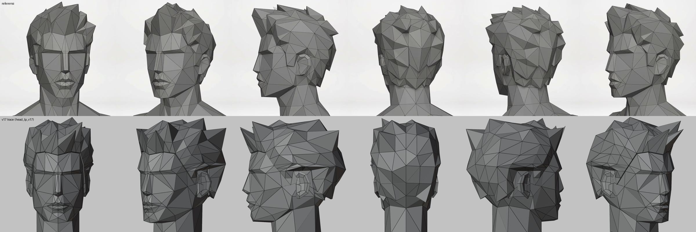
Atas referensi, bawah v17 (`output/head-game/template/head_lp_v17.blend`), sudut 0, 40, 90, 180, 240, 320.

## Cara
Script `tools/blender/head_trace.py`. Tidak ada loft cincin. Tiap vertex = satu landmark yang dibaca dari dua frame:
- **Depan f01**: setengah lebar dari garis hidung (x) dan tinggi (y). Dibaca dari crop bergrid 50 px, lalu crop zoom 2× per area (atas: dahi-alis-hidung, bawah: hidung-bibir-dagu).
- **Samping f06**: kedalaman (z). Tinggi samping dipetakan ke tinggi depan dengan `yf = 470 + (ys - 490) * 1.085`, karena frame samping sekitar 8 % lebih kecil (alis dan dagu dijadikan patokan).
- Skala: 0.0003 m per px depan. Ukuran kepala sama dengan v16f (dagu ke ubun 0.22 m), jadi topi dan frame game tetap pas.

Lalu muka segitiga **ditulis manual** sepanjang garis anatomi referensi:
- dahi: segitiga besar dari titik garis rambut ke rak alis;
- **rak alis**: bidang bawahnya menghadap ke bawah, jadi alur mata terbentuk sebagai bayangan (zona "groove" 0.62 × kulit);
- hidung: bidang depan datar (2 × 22 px), dua sisi, ujung, bawah hidung gelap;
- pipi: kipas dari **titik tulang pipi** ke mata, hidung, dan sudut mulut;
- bibir: atas berbentuk M, bawah lebih tebal, garis mulut gelap;
- dagu persegi + kipas dari sudut mulut;
- garis rahang ke sudut rahang di bawah telinga, bawah rahang satu bidang panjang ke leher tebal;
- tengkorak bulat di bawah rambut.

Setengah kepala ditulis (60 titik, 108 segitiga), sisi lain dicerminkan. Hasilnya tertutup rapat: 216 segitiga, 0 tepi bocor (dicek dengan bmesh).

Telinga = telinga v13/v16f, dipindah ke posisi trace (alis sampai bawah hidung, di belakang garis rahang) dan diskala 1.15. Mata = celah gelap tipis di alur (`Eyes`, untuk `faceLP` di game).

## Rambut (v17g)
Dua percobaan pertama gagal:
- *poke* semua muka cangkang menghasilkan piramid kecil di mana-mana (bulu babi);
- poke separuh muka masih acak dan tidak punya arah.

Kata user: "rambutnya jelek". Saya pelajari ulang referensi dari 6 sudut (`f03`, `f06`, `f08`, `f10`, `f13`, `f17`):
- Rambut = **massa tebal** dari bidang besar: sekitar 2-3 cm di atas dan belakang, tipis di garis rambut. Siluet bulat penuh.
- Duri **hanya di tempat tertentu**: deret ujung di ubun, jambul depan, helai samping di atas/belakang telinga yang menunjuk ke belakang, gigi di tengkuk.
- Duri = **titik permukaan yang ditarik jauh keluar**, jadi kipas segitiga di sekitarnya menjadi satu pecahan besar.
- Semua duri **condong ke belakang** dan menyapu ke satu sisi (belahan rambut). Duri tegak simetris terbaca sebagai mahkota punk.

Cara (`build_hair`):
1. Cangkang = muka kepala di atas garis rambut, dibagi sekali (titik lebih banyak untuk ditarik).
2. Volume: tiap titik didorong keluar. Tebalnya 3.5 mm di tepi, 8 mm di garis rambut, sampai sekitar 3 cm di ubun dan belakang.
3. Duri dipilih per zona, dan titik yang terpilih memblokir tetangganya supaya pecahan tidak berdempet:
   - jambul 4: naik, ke belakang, ke kiri;
   - ubun 6: belakang dan naik;
   - samping 4: ke belakang;
   - belakang 2: rebah ke bawah;
   - tengkuk 5: gigi turun, ikut ditarik dengan roknya supaya gigi tetap tebal.
4. Rok dari tepi rambut turun ke kulit, jadi tepi rambut punya ketebalan yang terlihat.

Total 200 segitiga.

## Koreksi samping (v17i): render diselaraskan dengan frame referensi
User: "lihat ini beda" (potongan samping). Saya buat `tools/blender/align_side.py`. Script ini merender kepala dari samping dengan kamera ortho yang skala dan pusatnya **sama persis** dengan frame f06 (0.000325 m/px, 1920×1080), lalu menaruhnya berdampingan atau menumpuknya dengan referensi.
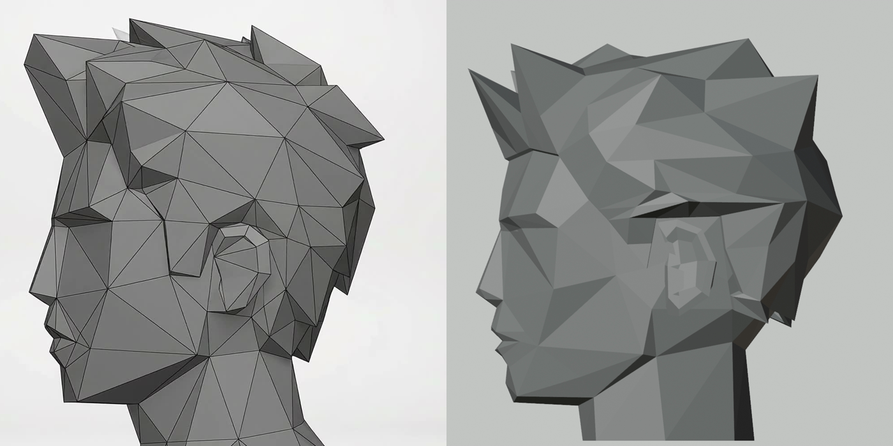
Ukuran kepala, wajah, dan siluet atas/belakang ternyata sudah pas. Yang salah:
- **Telinga tertutup rambut.** Tepi rambut memotong miring di atas telinga. Perbaikan: titik baru `SB_BACK`, `E_TOP_F`, `E_TOP_B`, `E_BACK_LO`, sehingga garis rambut **melingkari telinga**: cambang sempit di depan, lewat di atas telinga, turun di belakangnya. Kulit di bawah telinga punya mukanya sendiri.
- **Jambul** di referensi menjorok **ke atas-depan**, ujungnya hampir di atas ujung hidung, dan miring ke satu sisi. Sebelumnya saya buat condong ke belakang.
- **Rambut belakang** berhenti setinggi bawah telinga. Gigi tengkuk pendek dan mengarah ke belakang-bawah, tidak menggantung.
- **Telinga** diperbesar 1.35 (tinggi dan lebar) tetapi tonjolannya tetap, karena di referensi telinga rapat ke kepala dan hampir tak terlihat dari depan.

Pelajaran: bandingkan dengan **render yang diselaraskan** (skala dan kamera sama dengan frame), bukan render bebas. Beda posisi langsung terbaca.

## Volume rambut dari video berwarna (v17k)
User: "kanan kiri ini terasa kurang ada volumenya". Saya crop bagian rambut dari video turntable berwarna (frame 4 fps, crop kepala 300×260 diperbesar 2×). Di video berwarna, volume jauh lebih terbaca daripada di wireframe abu.
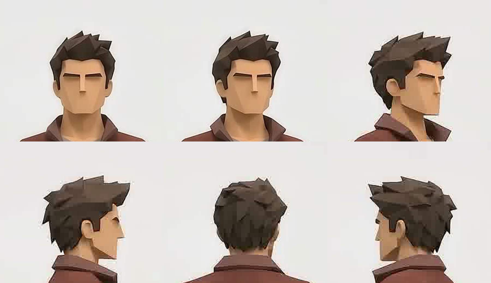
Ukuran dari crop:
- Depan: lebar rambut ≈ **1.45 × lebar wajah**. Panel samping tebal turun di pelipis sampai setinggi mata dan **membingkai wajah**.
- Puncak rambut ≈ 1 × (alis→dagu) di atas alis.
- 3/4 dan samping: rambut di atas dan belakang telinga **menggembung**, turun ke belakang telinga, dan **tepinya bergerigi** (ujung helai turun).
- Belakang: massa bulat, lebih lebar dari kepala.

Render pembanding: `tools/blender/col_turn.py`. Warnanya kulit dan rambut, framing sama dengan crop (ortho 0.44 m, 600×520).

Sebelum (v17i): lebar total sebenarnya hampir sama (0.092 vs target 0.088), tetapi angka itu datang dari **ujung duri**. Massa dasar menempel tipis di tengkorak.
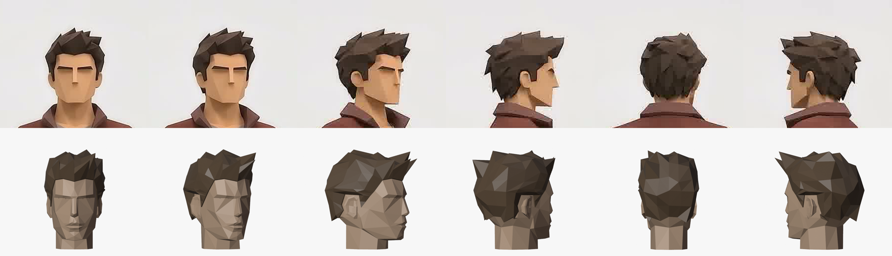
Perbaikan:
- Tebal dasar sekarang `t = 0.010 + 0.016·atas + 0.015·samping·(1 − 0.4·atas) + 0.012·belakang`. Faktor "samping" naik dari tengah ke pelipis/atas telinga. Tepi rambut 5 mm.
- **Gigi di seluruh tepi samping dan belakang** (sekitar telinga dan tengkuk), bukan hanya di tengkuk: turun, ke belakang, sedikit keluar. Roknya ikut ditarik.
- Zona duri samping diperluas sampai pelipis atas.
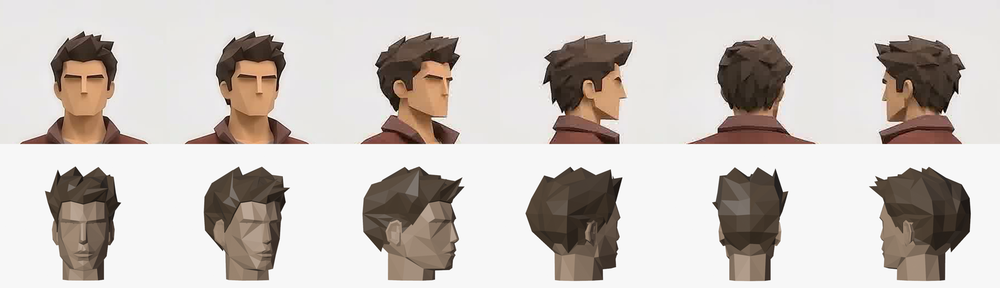

Pelajaran:
- Volume dinilai dari **render berwarna dengan framing sama**, bukan dari wireframe abu.
- Duri tidak memberi volume. Volume = **tebal massa dasar**.

## Helai sekunder (v17m), dari bacaan teknik rambut stylized
User: "masih kurang dikit, cari referensi lain atau bacaan". Halaman tutorial lengkap kebanyakan terblokir (Polycount 403, BlenderNation/Tripo 522). Ringkasan hasil pencarian yang konsisten:
- **Primer → sekunder → tersier**: massa helm dulu, lalu **gumpalan (clump)** sebagai bentuk sekunder, terakhir ujung atau helai kecil ([Bucknell, contoh pemodelan rambut](https://sculpture1.blogs.bucknell.edu/hair-modeling-examples/); [Polycount](https://polycount.com/discussion/comment/2780358)).
- **Arah global + arah per gumpalan**. Gumpalan dikelompokkan, ukurannya bervariasi, bentuknya C/S meruncing ([Clip Studio, stylised hair](https://tips.clip-studio.com/zh-tw/articles/6072?org=1)).
- Siluet harus jelas. Kerjakan bentuk besar sebelum detail ([Polycount, layering](https://polycount.com/discussion/224290/stylized-hair-brakeup-layers-techniques); [80.lv](https://80.lv/articles/3d-artist-shares-hair-styling-workflow-in-zbrush)).

Yang kurang di v17k: hanya ada bentuk primer (satu permukaan, titik ditarik). Tidak ada lapisan, jadi tidak ada anak tangga yang memberi bayangan.

Cara baru (`add_clumps`):
- ~27 helai terpisah di atas helm. Pangkal dipilih dengan jarak minimal 4.6 cm, jadi sedikit dan besar.
- Bentuk helai: penampang segitiga (kiri, punggung, kanan) di pangkal → lebih sempit di tengah → ujung. Punggungnya memberi satu bidang terang dan satu bidang gelap.
- Helai **berjalan di permukaan dalam dua langkah**: arah diproyeksikan ulang di tengah, sehingga mengikuti lengkung kepala.
- **Aliran global** (`flow_dir`): jambul di dahi naik, atas ke belakang, samping dan belakang ke belakang-bawah.
- Ujung diangkat dari permukaan: jambul 3.6 cm, ubun 3.4 cm, atas 2 cm, samping 0.7 cm. Hasilnya siluet atas yang runcing.
- Warna per helai sedikit beda (0.93-1.05), supaya lapisan terbaca tanpa terlihat belang.
- Duri tarik titik dibuang, kecuali gigi tepi di samping dan tengkuk.

Masalah dan perbaikannya:
- Percobaan pertama: 44 helai kecil dengan variasi warna kuat. Hasilnya ramai dan belang.
  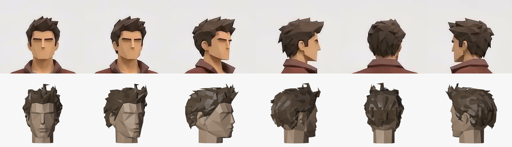
- Ada helai terpelintir: arah sisi di tengah helai terbalik dari pangkalnya. Perbaikannya, arah sisi dipaksa searah.
- Helai menjadi jarum tegak karena ujungnya keluar lurus ke udara. Perbaikannya: berjalan di permukaan dua langkah.
- Lengkungan aneh muncul di jambul karena duri lama bertabrakan dengan helai. Duri itu dibuang.

Hasil:

Rambut 566 segitiga. Ini mahal untuk game: sebelumnya 244, dan satu survivor sekitar 1900. Bisa dihemat dengan helm tanpa subdivide, karena helm hampir seluruhnya tertutup helai.

## Kembali ke massa + duri, dengan variasi (v17n)
User: "kaya awal aja, cuma mau lebih bervariasi siluet dan runcingnya". Helai sekunder dimatikan (`CLUMPS = False`, kodenya tetap ada). Gaya yang dipilih: massa tebal dari bidang besar yang bersih, plus duri tarik titik.

Variasi yang ditambahkan:
- **Panjang duri berekor**: `m = 0.55 + 1.35·r²`. Kebanyakan sedang, beberapa sangat panjang, beberapa pendek. Ekor 1.75 terlalu jauh dan menghasilkan duri seperti tanduk.
- **Arah dibelokkan acak** di bidang singgung (±45 %), jadi duri yang bertetangga tidak sejajar.
- **Massa berbenjol**: tebal per titik × 0.78–1.22, supaya siluet tidak licin.
- **Duri ubun mengarah ke atas** (0.78 naik). Duri yang mengarah ke belakang tidak terlihat di siluet depan.
- **Jentikan samping** ke luar dan atas di pelipis. Zona ini diberi prioritas di atas zona ubun, karena kalau tidak, semuanya tertelan oleh ubun.
- Jumlah duri: jambul 4, ubun 7, samping 4, gigi tepi 13.

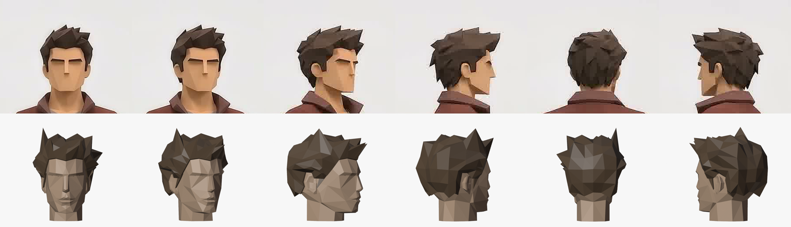
Rambut 252 muka.

## Satu medan aliran (v17o)
Catatan user (coretan merah): "aliran rambut yang berantakan dan bertabrakan".
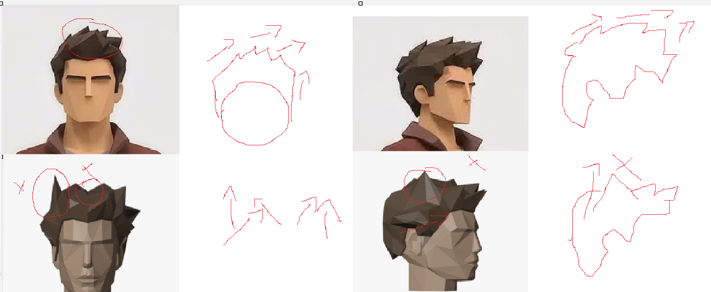
- Referensi: **atas/ubun mengalir ke depan**. Ujung-ujungnya naik ke depan-atas dan condong ke satu sisi (kiri karakter). Jambul menunjuk ke depan. Samping naik. Belakang turun.
- v17n: arah per zona plus belokan acak, jadi duri bertetangga saling silang (lekuk V di tengah, duri tegak seperti tanduk).

Perbaikan:
- `hair_flow(h)` = **satu medan aliran** dengan zona yang dicampur halus (smoothstep):
  - atas (0.35, 0.45, 0.82) → depan, naik, kiri;
  - samping (±0.35, 0.9, −0.25) → naik;
  - belakang (0.1, −0.55, −0.83) → turun.
- Duri bertetangga hampir sejajar dan **hanya beda panjang** (0.7–1.35×). Tidak ada belokan acak.
- Ujung duri diangkat dari permukaan supaya siluet bergerigi. Untuk ubun dan jambul, angkatannya ke **atas** (0.35·normal + atas), bukan sepanjang normal, karena normal di sisi kepala menghadap keluar dan menghasilkan tanduk.
- Kalau ekor panjang terlalu lebar, satu duri menjulang sendirian. Rentang 0.7–1.35× sudah cukup bervariasi.

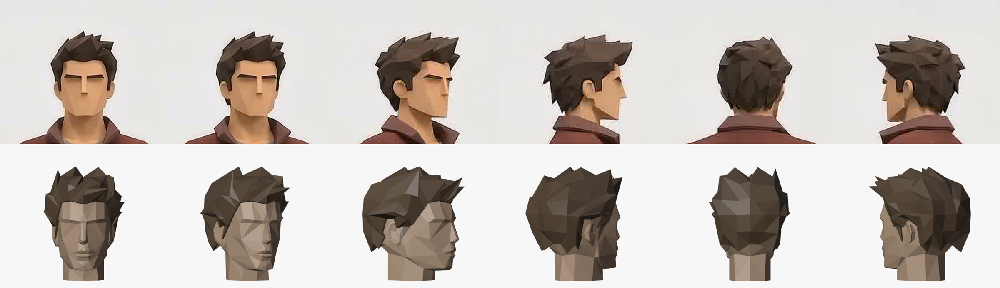

Duri tanduk di sudut kiri atas (kanan karakter), yang muncul **sejak versi pertama**. Penyebabnya:
1. Zona jambul hanya dibatasi "depan + atas", tanpa batas ke samping. Akibatnya sudut depan-atas di sisi kepala mendapat duri terpanjang, dan duri itu berdiri tepat di tepi siluet.
2. Pemilihan duri memakai hash tetap per posisi, jadi titik yang sama terpilih di setiap versi.
3. Hash tidak simetris, sehingga sisi lawannya tidak mendapat duri serupa.

Perbaikan: jambul hanya di tengah depan (|x| < 0.035), dan panjang duri atas dikurangi sampai 45 % ke arah tepi kepala. Puncak kiri dan kanan sekarang 0.144 / 0.149, sebelumnya 0.162 / 0.149.

Rambut di atas telinga "menggantung, tidak menempel" (catatan user, v17p).
- Penyebab: massa samping tebal (~3 cm) berhenti mendadak di tepi. Bagian bawahnya jadi atap yang mengambang di atas telinga. Gigi tepi juga ditarik lurus ke udara.
- Perbaikan:
  - Tebal **menipis mendekati tepi samping/belakang**: × (0.3 + 0.7·smoothstep(jarak ke tepi, 0, 3.5 cm)), dan tepinya 2 mm. Tepi dahi tetap 5 mm.
  - Gigi tepi ditarik **sepanjang permukaan** (diproyeksikan ke bidang singgung, sedikit masuk).

Kedua sisi dicek:
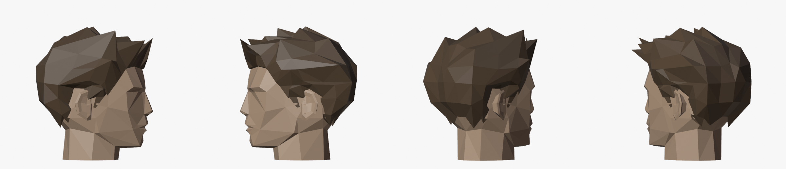

Celah kulit antara rambut dan telinga (v17q). User: "di contoh tidak ada celah rambut dan telinga".
- Penyebab: titik tepi rambut di sekitar telinga dulu diletakkan untuk telinga skala 1.15. Setelah telinga diperbesar ke 1.35, tersisa pita kulit di atas, depan, dan belakang telinga.
- Perbaikan: telinga diukur ulang (kedalaman 471–608 px, tinggi 468–702 px), lalu titik tepi dipasang **tepat di tepi telinga**:
  - `E_TOP_F`/`E_TOP_B` di y 485, jadi puncak telinga terselip di bawah rambut;
  - `SB_BACK` di depan telinga (cambang menempel);
  - `SK_BEHIND`/`E_BACK_LO` di belakang telinga.
- Penipisan tepi dikurangi (minimum 0.45), supaya tepi di atas telinga masih punya badan.
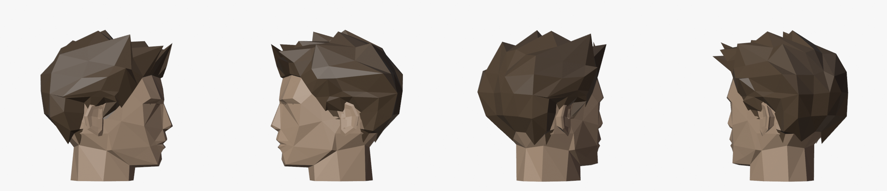

User masih melihat celah di depan dan belakang telinga (v17r). Render dekat dengan wireframe (`tools/blender/ear_close.py`, ortho 12 cm di telinga):
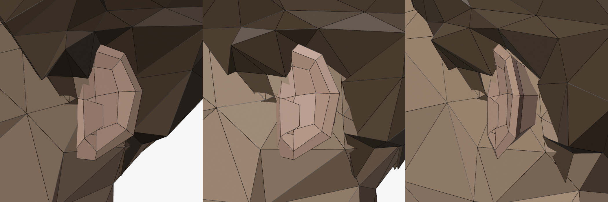
- **Sisi bawah gelap:** di sekitar telinga, massa rambut masih terangkat ~1 cm sementara tepinya di kulit. Bidang di antaranya menghadap ke bawah, jadi terbaca sebagai celah atau atap. Perbaikan: `ear_near(h)` (1 di telinga, 0 dari ~6 cm), tebal × (1 − 0.85·ear_near). Gigi tepi dan jentikan dekat telinga dihilangkan.
- **Petak kulit di balik telinga:** telinga berbentuk C dan menonjol ~1.3 cm. Perbaikan: titik tepi rambut digeser ke bawah telinga, dan pangkal telinga `EAR_C` masuk zona rambut. Hasilnya lapisan tipis rambut **menyelip di bawah telinga**, tapi hanya di bagian belakang pangkal. Di depan pangkal, rambut sempat menutupi mangkuk telinga.
- **Efek samping:** jentikan samping tanpa batas ke belakang menghasilkan duri mendatar 6.5 cm di balik telinga (ketemu dengan mencari titik rambut terjauh dari kepala). Perbaikan: jentikan hanya di pelipis (−0.025 < z < 0.04).
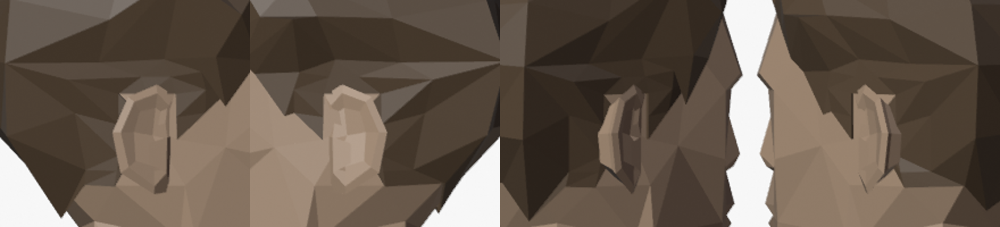

Pelajaran: kalau ukuran satu bagian diubah (telinga), **titik yang bergantung padanya ikut diukur ulang** (tepi rambut).

Pelajaran: variasi rambut = **panjang yang beda, arah yang sama**. Massa rambut harus **menipis ke tepinya**, kecuali di tepi yang memang dimaksudkan tebal, seperti poni. Arah acak terbaca sebagai berantakan atau bertabrakan.

## Total
Kepala 232, rambut v17n 252 muka, telinga 88 muka, mata 2. Kira-kira sama dengan v16f, tapi bentuknya jauh lebih dekat ke referensi.

## Sisa beda dengan referensi
- Belakang referensi: lebih banyak lipatan helai (takik V gelap), dan massanya lebih bulat dan lebar di bawah.
- Bibir dan hidung sudah ada, tetapi masih lebih halus dari referensi (referensi punya lebih banyak titik di bibir).

## Pelajaran
- **Trace dua pandangan** (depan untuk x/y, samping untuk z) + segitiga manual = bentuk wajah benar dalam satu kali coba. Dengan loft cincin, puluhan versi tidak sampai ke sini.
- Kalau frame depan sedikit miring, ukur lebar dari **kedua sisi lalu rata-ratakan**.
- Cek manifold otomatis (tepi dengan jumlah muka ≠ 2) sangat penting saat menulis segitiga dengan tangan.
