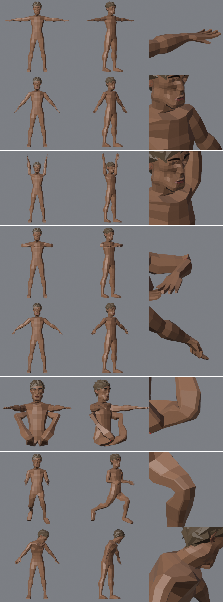
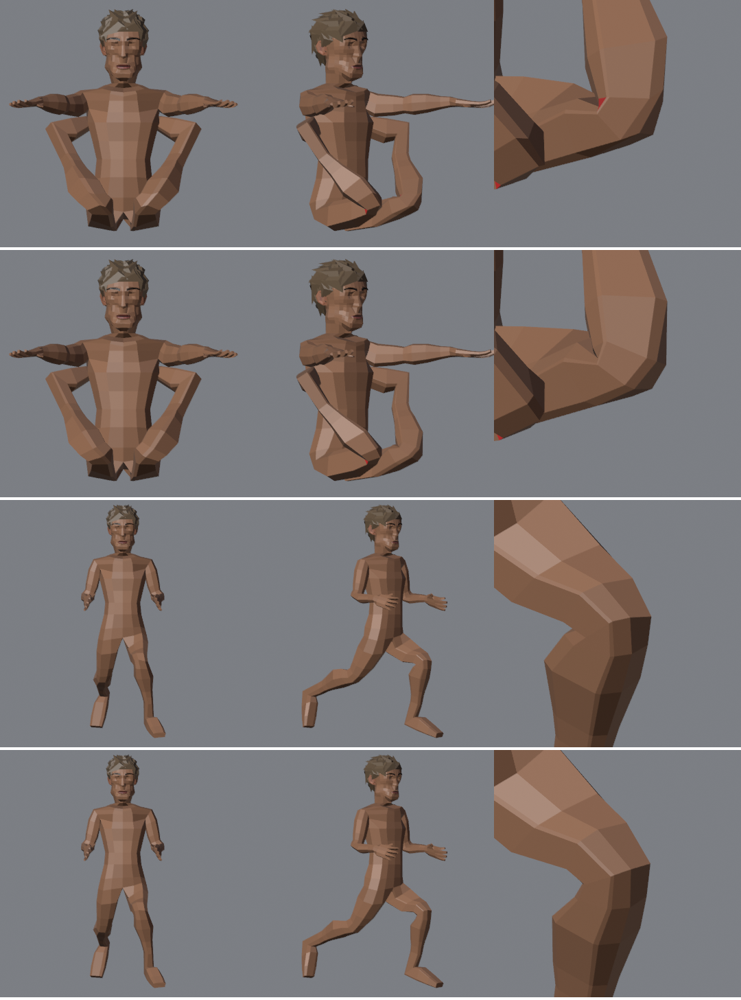

# Kartu part: rig game (survivor v11)

Rig tulang deform saja (tanpa control rig Rigify), supaya langsung jalan di three.js / Unity / Godot lewat glb.
Kode: `tools/blender/rig_game.py`. Uji: `tools/qa/deform_test.py` (E4).
Hasil: `output/ref/survivor/survivor_v11_rig.blend`, glb `output/qa/survivor_v11_rig.glb` (321 KB, skin + warna, 2678 tris).
**v12** (badan atas diperbaiki, lihat [Alat QA](../alat-qa.md)): `survivor_v12_rig.blend` / `.glb`, E4 sama kecuali menoleh sekarang bersih; viewer memakai v12.

```
ref_body.py (RB_TAG=ref_body_v11j)  -> joints_ref_body_v11j.json   (mesh sama persis dengan v11base)
blender -b survivor_v11.blend -P tools/blender/rig_game.py -- --joints output/ref/survivor/joints_ref_body_v11j.json --out output/ref/survivor/survivor_v11_rig.blend
blender -b survivor_v11_rig.blend -P tools/qa/deform_test.py
```


Baris: rest, A-pose, tangan ke atas, siku 120°, kepalan, jongkok, lari, badan + kepala menoleh. Kolom: depan, 3/4, close-up sendi. Merah = face terbalik atau kolaps.

## Tulang (53, 52 deform)
- root (tidak deform) > hips > spine > chest > upper_chest > neck > head
- upper_chest > shoulder > upper_arm > forearm > hand > thumb / index / middle / ring / pinky .01–.03
- hips > thigh > shin > foot > toe
- Posisi sendi tidak ditebak dari mesh: **ref_body.py menulis pusat cincin sendi** (siku = cincin tengah dari 3, lutut = cincin di `kn`, ruas jari = cincin tiap ruas) ke `joints_<tag>.json`. Tulang belakang dan kepala dari irisan mesh.
- Roll: lengan dan jari sumbu Z ke atas, kaki Z ke depan.

## Bobot
Bobot buatan sendiri, bukan automatic weights (bone heat):
1. Tiap titik ke tulang dengan skor terkecil `jarak ke ruas tulang / radius tulang` (radius = bagian dari tinggi badan; badan lebar menang atas pangkal lengan di sebelahnya).
2. Pita leher (antara dasar leher dan pivot kepala) dipaksa ke `neck`. Tanpa ini leher kosong dan rahang terlipat saat menoleh.
3. Dihaluskan 3 kali lewat tepi mesh: campuran ±2 cincin di tiap sendi. Tidak bocor antar jari karena jari hanya tersambung lewat telapak.
4. **Lutut (engsel):** bagian paha/betis diatur ulang dengan smoothstep sepanjang kaki: setengah lebar 0.04 × tinggi di depan (tempurung), 0.12 × tinggi di belakang (lipatan). `HINGES` di skrip; siku punya opsi sama tapi mati.
5. Sisi kanan disalin dari kiri (simetri pasti), maksimal 4 tulang per titik, bobot < 0.03 dibuang.

## Hasil E4
| Pose | Face terbalik | Face kolaps | Catatan |
|---|---|---|---|
| A-pose, tangan ke atas, kepalan, lari | 0 | 0–1 | bersih |
| siku 120° | 4 | 2 | lipatan dalam siku |
| jongkok (paha 100°, lutut 120°) | 0 | 2 | bersih sejak engsel lutut |
| badan + kepala menoleh 85° total | 1 | 0 | rahang |

Volume sendi terburuk: lutut 0.77, bahu 0.87, siku 0.92 (gerbang ≥ 0.7, lolos).
**Batas tanpa face terbalik:** siku 110°, **lutut 130°** (dulu 90°), kepala menoleh 60°. Jalan, lari, jongkok aman; siku penuh masih melipat.

## Riwayat
| Versi | Bobot | Masalah | Perbaikan |
|---|---|---|---|
| a | bone heat | tidak simetris: siku kiri 0.69/0.31, kanan 0.19/0.81; jari bocor ke jari sebelah; 15 face terbalik | bobot cincin sendiri + mirror |
| b | cincin | `neck` tanpa titik, rahang terlipat saat menoleh | pita leher dipaksa |
| c | cincin | belakang lutut terbalik di 90° | radius paha = radius betis |
| d | + cincin lutut kn±0.025 (5 cincin) | terbalik mulai 60° (face belakang kecil saling silang) | dibuang |
| e | + cincin lutut menguncup di belakang (pinch 0.6 / 0.75) | terbalik mulai 80° | dibuang |
| **f** | + engsel lutut 0.04 / 0.12 | bersih sampai 130°, volume 0.77 | dipakai |
| f-siku | engsel siku 0.03 / 0.1 | tidak terbalik sampai 140°, tapi volume 0.92 → 0.79, bentuk sama | tidak dipakai |

## Pelajaran
- **Lipatan sendi diperbaiki di bobot, bukan dengan menambah cincin.** Cincin rapat di lutut low-poly malah membuat face belakang kecil saling silang lebih cepat. Bobot engsel: campuran lebar di sisi lipatan, sempit di sisi tempurung.

Atas → bawah: jongkok lama, jongkok engsel, lari lama, lari engsel. Lama: takik tajam ke dalam di belakang lutut.
- **Bone heat tidak bisa dipercaya untuk simetri.** Bobot otomatis kiri dan kanan bisa beda jauh. Bobot hitung sendiri + salin ke kanan.
- **Radius beda dalam satu anggota badan menggeser garis 50/50 dari sendi** ke arah tulang yang lebih kurus (paha 0.05 vs betis 0.035 → 8 cm di bawah lutut). Siku justru lebih baik dengan sedikit geser ke lengan bawah (lengan atas 0.03, bawah 0.025). Uji dengan sapuan sudut, bukan satu pose.
- **Generator yang tahu strukturnya sendiri sebaiknya menulis posisi sendi**, daripada menebak sendi dari mesh nanti.
- Importer glTF Blender menambah icosphere 80 face sebagai bentuk tulang: jangan dihitung sebagai triangle model.
- Pose uji harus masuk akal: siku 120° dengan lengan ke bawah membuat tangan menembus dada (masalah pose, bukan bobot).

## Berikutnya
- Siku dan lutut: tulang bantu (helper) atau corrective shape key kalau butuh tekuk penuh.
- ~~Uji gerak di browser~~: sudah, lihat [Uji gerak](../uji-gerak-viewer.md) (`?pair=survivor`).
- Kalau butuh kontrol animator: Rigify dibangkitkan dari tulang yang sama, ekspor tetap tulang deform ini.
