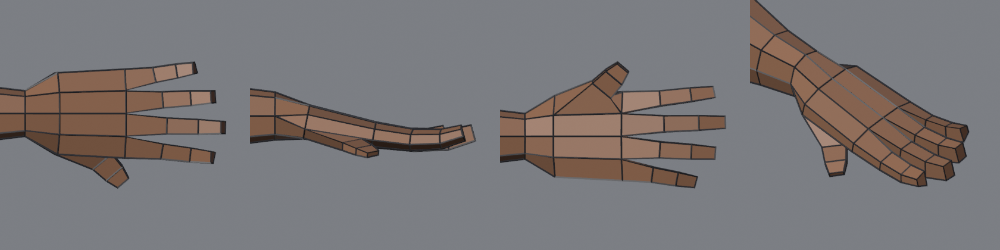

# Kartu part: tangan (jari)

Mengganti tangan mitten di survivor. Kode di bagian `# ---- hand` di `tools/blender/ref_body.py`, dengan konstanta `HAND_ANG`, `PALM_LEN`, `FINGERS`, `FINGER_SEG`, `FINGER_CURL`, `FINGER_SIZE`.
Hasil: `output/ref/survivor/survivor_v11.blend`. Cara mengikuti [tutorial Rozi 3D](../tutorial-rozi3d-lowpoly-karakter.md) part 1: buku jari dipotong jadi 4 face, tiap face di-extrude jadi jari.

Dari kiri: atas (punggung tangan), depan, bawah (telapak), 3/4.

## Topologi
- **Pergelangan → telapak:** cincin lengan 8 titik menjadi cincin telapak 10 titik. Kedua titik samping dipecah jadi dua, dengan 1 segitiga per sisi. Hanya 2 segitiga ini di tangan; selebihnya quad.
- **Telapak:** 2 cincin 10 titik (di 16 % dan 50 % dari pergelangan ke ujung jari tengah).
- **Ujung buku jari:** baris atas 5 titik dan baris bawah 5 titik, jadi 4 quad. Tiap quad = pangkal satu jari.
- **Jari:** tabung 4 titik, 3 cincin (ruas proksimal, tengah, distal) + tutup ujung, total 13 quad per jari. Ada cincin di tiap sendi, jadi rig bisa menekuk.
- **Jempol:** dari face telapak depan-bawah (antara cincin telapak 1 dan 2), tabung kotak 3 cincin, arah ke depan sepanjang telapak dan sedikit ke bawah.
- Kelingking 0.72, manis 0.9, tengah 1.0, telunjuk 0.9 × panjang jari tengah. Jari menyebar ±10°, melengkung ke telapak 3°/9°/14° per ruas.

## Riwayat
| Versi | Masalah | Perbaikan |
|---|---|---|
| v11a | jari menyatu berpasangan | tanda sudut sebaran terbalik |
| v11a | jempol menukik ke bawah seperti bilah | arah ke bawah dikurangi; cincin jempol kotak dengan ukuran sendiri (offset radial), bukan pemetaan face pangkal |
| v11b | kelingking dan telunjuk kurus seperti jarum | sudut cincin telapak dihitung ulang supaya 4 face buku jari sama lebar setelah bentuk kotak: titik atas di \|sin a\|^(2/3) = 0.5 → a = 21° |
| **v11** | 4 jari rata + jempol | E1 30/30, 2678 tris, quad 88 %; **disetujui user (6 Nov)** |

## Pelajaran
- **Sudut sama ≠ jarak sama.** Superellipse kotak memampatkan titik di dekat sudut. Kalau butuh kolom selebar sama, hitung sudut dari lebar yang diinginkan (balik rumus `se`).
- **Jangan memetakan ukuran face pangkal langsung ke tabung yang arahnya lain** (jempol). Ambil arah sudutnya saja, lalu beri ukuran sendiri.
- **IoU bisa turun karena detail yang benar.** Siluet referensi menggambar jari rapat, jadi celah antar jari mengurangi IoU depan (0.892 → 0.888). Nilai dengan mata di close-up, bukan IoU saja.

## Berikutnya
- Rig: sudah, lihat [Rig game](rig.md) (3 tulang per jari + jempol, kepalan lolos E4 tanpa face terbalik).
- Kuku dan buku jari bisa dilukis di tekstur, bukan geometri.
