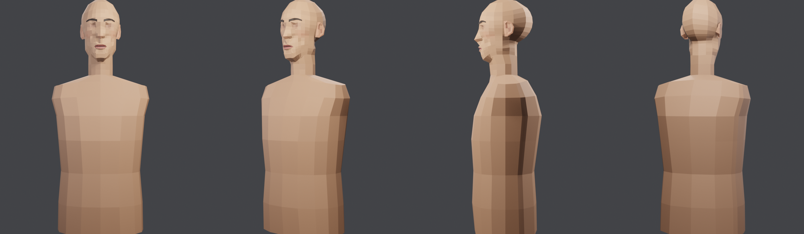
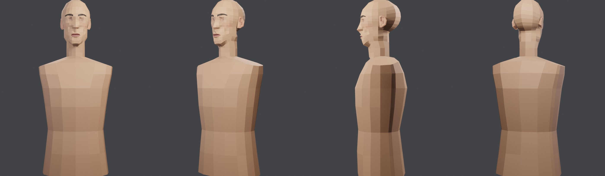
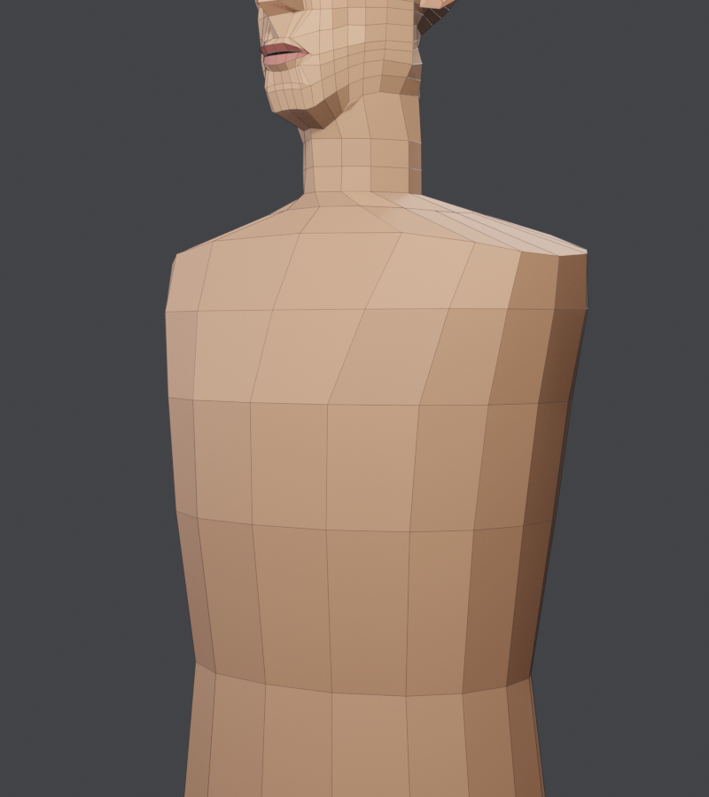

# Kartu part: torso (leher bawah, bahu, dada, pinggang, pinggul)

Part kedua sesuai [Konsep part modular](../konsep-part-modular.md). Keputusan user (3 Nov 2026): **jahit kulit**, **konektor leher 10 titik**, **dibangun di Blender**.
Kode: `tools/blender/torso_part.py` (`TORSO_RINGS`, `TORSO_COLS`). Hasil: `output/head-game/template/head_bust_v*.blend`. Render: `head_paint.py` dan `wire_render.py` dengan `PAINT_TGT_Z=-0.33 PAINT_DIST=2.1` / `WIRE_TGT_Z=-0.33 WIRE_DIST=2.3`.

## Sumber ukuran
- `src/zombie/lowbody/refBody.json` (male, tinggi 1.729 m): depan, belakang, dan setengah lebar badan setiap 1 % tinggi.
- Tinggi dagu ref (0.87 × 1.729 m) sama dengan dagu kepala kita, jadi skalanya 1:1: **y kepala = frac × 1.729 − 1.625**.
- Baris bahu di ref ikut lengan (setengah lebar 23 cm). Untuk torso tanpa lengan dipakai 18–18.6 cm.

## Topologi
- Cincin 16 titik. Kolom setengah cincin: 0, 22, 48, 70, 90, 110, 120, 150, 180°. Kolom ini **memuat semua kolom leher kepala** (0, 22, 48, 90, 120, 180) ditambah 70, 110, 150 untuk bahu.
- Leher (10) ke trapezius (16): muncul muka 5 sisi di tempat kolom baru dimulai, sama seperti pita kolom di kepala.
- Tiap cincin: (y depan, y samping, y belakang, depan, belakang, setengah lebar, eksponen superellipse). Y yang berbeda di depan, samping, dan belakang membuat garis bahu menurun ke ujung bahu.

## Konektor
| Konektor | Bentuk | Tag `body_zone` |
|---|---|---|
| leher ↔ kepala | cincin 10 titik kepala (y −0.172). Tutup kepala (2 segienam hasil cermin) dihapus, lalu 10 pasang titik di-weld | – (sudah dijahit) |
| lengan | 4 quad di sekitar titik samping cincin `armpit_top` (batas 8 titik, seperti F2) | 5 |
| kaki | tutup bawah cincin `hips` | 6 |

Muka yang ditag 5 dan 6 adalah tutup sementara. Part lengan atau kaki akan menghapus tutup itu lalu dijahit ke batasnya.

## Riwayat
| Versi | Isi | Hasil |
|---|---|---|
| v1 | 7 cincin dari refBody | tertutup, simetri sempurna; 232 tris torso. Bentuk seperti karung: bahu rata, leher terlihat panjang, tidak ada dada atau pinggang |
| **v2** | + cincin trapezius, bahu menurun dan kotak (eksponen 3), dada maju, pinggang menyempit (V) | 264 tris torso, total 1170 tris; tertutup, simetri sempurna. Masih seperti manekin tanpa lengan; menunggu penilaian |

## Pelajaran
- **Tutup leher kepala terbelah dua** oleh mirror weld (2 segienam). Hapus semua muka yang seluruh titiknya ada di cincin, dengan mode `FACES` supaya edge tengah yang tersisa ikut hilang. Kalau tidak, mesh tidak tertutup.
- **Kolom part bawah harus memuat semua kolom konektor part atas.** Dengan begitu, jahitan cukup weld titik yang sama posisinya, tanpa membuat titik baru.
- Ukuran dari referensi yang memuat lengan (lebar bahu) harus dikurangi untuk torso tanpa lengan.

## Berikutnya
- Penilaian user untuk bentuk torso.
- Part lengan (konektor 8 titik), lalu part kaki (konektor pinggul).
