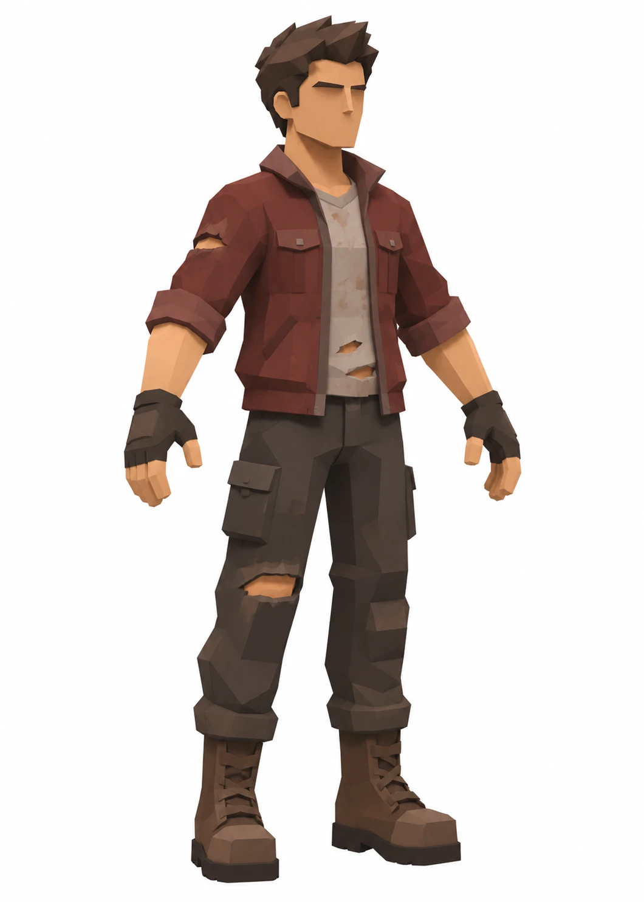
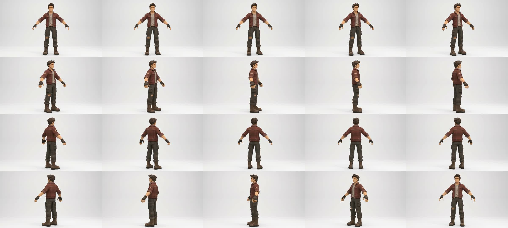
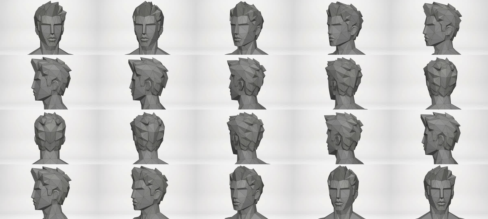
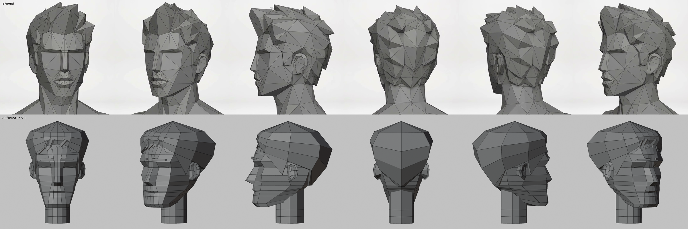
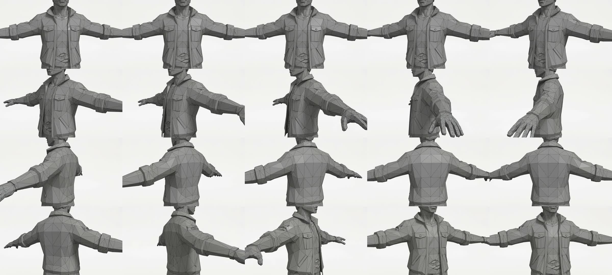
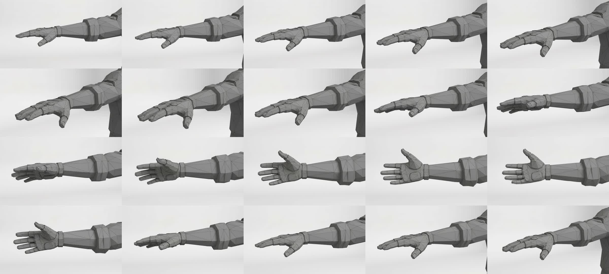
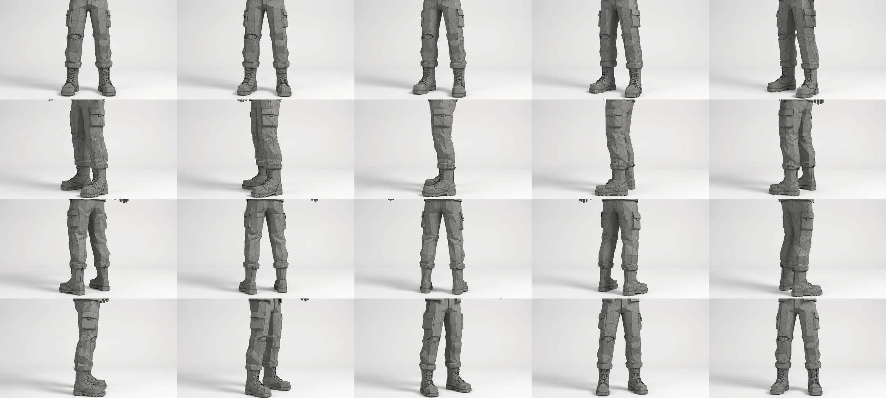

# Studi referensi: survivor jaket merah (5 video wireframe)

Sumber: 5 video 10 detik dari user (full warna, kepala, torso, lengan, kaki) + 2 gambar. Frame 2 fps (20 per video) di `attachments/ref/survivor_ref/<bagian>/fNN.jpg`, lembar kontak `<bagian>_sheet.jpg`.

## Gaya umum
- **Semua segitiga**, ukuran tidak rata: besar di bidang lebar (pipi, punggung, paha), rapat hanya di tempat yang butuh bentuk (bibir, hidung, jari, tali bot). Kepadatan ikut kebutuhan bentuk, bukan grid.
- **Lapisan = kulit terpisah dengan tebal**: jaket di atas kaos, manset gulung, ujung celana gulung, kerah. Tiap lapisan punya tepi tebal yang terlihat (tangga).
- **Detail = bentuk kecil yang menonjol**, bukan warna: kantong dada (kotak + tutup + kancing segi enam), saku samping celana, tali bot, sol bergigi.
- Warna flat per bahan (jaket merah marun, kaos abu krem, celana cokelat tua, bot cokelat), sedikit noda dan sobekan (lubang dengan kulit di dalam).
- Proporsi: kepala sekitar 1/7, bahu lebar kotak, kaki panjang lurus, tangan dan bot agak besar (gaya game).

## Kepala

- Wajah **panjang sempit**. Dahi bidang lebar. **Tulang alis** = pita horizontal yang menjorok, dengan bayangan di bawahnya. Mata hanya **celah/garis** di bawah alis, tanpa bola mata.
- **Batang hidung persegi panjang** lurus dari alis ke ujung hidung (bidang depan datar + 2 sisi). Ujung hidung segitiga, lubang hidung = takik segitiga gelap.
- **Pipi**: satu bidang besar dari tulang pipi ke sudut rahang. Garis rahang tegas, **dagu persegi**.
- Bibir dipahat: bibir atas bentuk M (kipas segitiga kecil), bibir bawah lebih tebal. Hanya bagian ini yang rapat.
- **Telinga**: mangkuk C sederhana dengan pinggir, di belakang garis rahang, setinggi alis sampai hidung.
- Leher tebal, tabung 8–10 sisi, menyambung ke trapezius miring.
- **Rambut**: helm dasar + **lapisan pecahan (shard) besar**. Jambul depan naik dan menyapu ke belakang, panel samping menyapu ke belakang di atas telinga, ujung runcing mencuat di atas (siluet bergerigi). Tengkuk = **deret gigi segitiga** turun (zigzag). Cambang = takik di depan telinga. Tebal rambut 2–4 cm, tiap gumpal 6–12 cm.

### Kepala: studi mendalam (referensi vs v16f, sudut sama)

Atas referensi (frame f01, f03, f06, f10, f13, f17), bawah v16f (`head_lp_v6`) dirender abu + wire di sudut 0, 40, 90, 180, 240, 320.

Ukuran dari frame depan f01 (piksel 1080p, tinggi wajah = garis rambut → dagu = 605 px):
| ukuran | nilai | rasio |
|---|---|---|
| garis rambut → alis | 170 | 0.28 tinggi wajah |
| alis → bawah hidung | 205 | 0.34 |
| bawah hidung → dagu | 230 | **0.38 (sepertiga bawah terpanjang)** |
| lebar wajah (tulang pipi) | 440 | tinggi / lebar = **1.37** |
| lebar dagu | ~250 | 0.57 lebar wajah |
| lebar mulut | 185 | 0.42 |
| lebar batang hidung | 60 | 0.14 |
| lebar leher | 360 | **0.82 lebar wajah** |
Samping (f06): telinga dari setinggi alis sampai bawah hidung, pusatnya sekitar 58 % kedalaman kepala dari ujung hidung. Garis bawah rahang = diagonal panjang dari dagu ke bawah telinga.

Beda utama:
1. **Topologi.** v16f = cincin horizontal quad (loft), jadi wajah tampak **bergaris-garis** (itu sumber pita terang-gelap di game). Referensi = **segitiga yang mengikuti garis anatomi**: garis alis, tulang pipi, garis rahang, lipatan hidung-mulut. Segitiga besar mengipas dari titik-titik itu.
2. **Rambut.** v16f = helm halus mengembang di atas dan belakang (bentuk **jamur**). Referensi = rambut **menempel ke tengkorak**, volume dari **pecahan runcing** yang saling tumpang, siluet bergerigi, tengkuk berakhir zigzag sehingga leher kelihatan.
3. **Tengkorak.** Referensi: belakang kepala bulat dan penuh, puncak kepala bundar. v16f: puncak rata, dan volumenya datang dari rambut, bukan tengkorak.
4. **Wajah bawah.** Referensi: rahang hampir selebar tulang pipi, sudut rahang tegas, dagu persegi lebar (0.57). v16f menyempit ke dagu kecil (trapesium terbalik).
5. **Leher.** Referensi tebal (0.82 lebar wajah) dan menyatu ke trapezius. v16f = tusuk tipis.
6. **Mata.** Referensi tanpa objek mata: mata = **alur bayangan** di bawah tepi alis yang menjorok, selebar wajah. v16f memakai lempeng kecil.
7. **Mulut dan hidung.** Referensi: bibir bervolume (bibir atas M, bawah tebal, segitiga kecil). Batang hidung panjang dan sempit, ujung lebih rendah. v16f: mulut hanya pita warna (tidak terlihat di render abu).
8. Telinga v16f sudah mirip (mangkuk C), posisinya sedikit lebih tinggi dan lebih depan.

Rencana kepala v17: **trace** referensi seperti telinga v13. Titik-titik dari frame depan f01 (x, y) dan samping f06 (z, y) dicocokkan per vertex, lalu muka segitiga disusun mengikuti garis anatomi. Kepala dibangun tanpa loft cincin. Rambut jadi objek pecahan terpisah di atas tengkorak yang bulat.

## Torso dan jaket

- Jaket **terbuka**: dua sisi depan dengan **tepi tebal (placket)**, kaos terlihat di tengah.
- **Kerah** berdiri lalu terlipat, lebar menyebar ke bahu.
- **Kantong dada** 2: kotak menonjol + tutup (flap) + kancing segi enam. **Saku miring** (celah) di bawah perut.
- **Pinggang jaket** = pita tebal (waistband), jaket berhenti di pinggul. Badan jaket kotak, jatuh lurus dari dada (sama dengan pelajaran drape).
- Punggung: bidang besar, **yoke** (garis bahu belakang), sedikit lipatan di ketiak.
- Lengan set-in (sambungan di bahu). **Lengan digulung**: manset tebal di bawah siku (cincin besar bertangga, ~2× tebal lapisan lain).
- Kaos: leher V/bulat, sobekan di perut (lubang dengan pinggir tidak rata).

## Lengan dan tangan

- Lengan bawah telanjang: tabung meruncing 6–8 sisi, bidang panjang.
- **Sarung tangan tanpa jari**: pita pergelangan, punggung tangan dengan bantalan, jari keluar.
- Tangan: 4 jari terpisah (3 ruas, kotak), ibu jari terpisah miring. Telapak dengan bantalan. Ini bagian paling rapat setelah wajah.

## Kaki, celana, bot

- Celana kargo: paha lurus lebar, **saku samping** kotak menonjol dengan tutup dan kancing (di sisi luar paha, tengah). Lutut sedikit menonjol, sobek di satu lutut.
- **Ujung celana digulung** di atas bot: cincin tebal (manset), lalu masuk/menumpuk di atas bot.
- **Bot tinggi** (setengah betis): batang hampir silinder, **tali silang** + lubang tali di depan, kaki kotak dengan **ujung tumpul persegi**, **sol tebal bergigi** (tumit terpisah). Bot besar → kaki terbaca jelas.

## Dibanding lp1 kita (game DEADZONE)
| Bagian | Referensi | lp1 sekarang | Langkah |
|---|---|---|---|
| Kepala | wajah panjang, alis menjorok, hidung persegi, rahang & dagu persegi | sudah mirip (v16f) | perkuat pita alis, mata celah, wajah lebih panjang |
| Rambut | shard runcing, jambul, gigi tengkuk | helm halus + 3 helai pipih | rambut shard baru (bagian terpenting untuk siluet) |
| Torso | jaket terbuka di atas kaos, kerah, kantong | kaos loft | part `jacket` (lapisan, tint sendiri) + kantong |
| Lengan | lengan gulung + manset tebal, lengan bawah telanjang | manset tipis di atas siku | manset tebal; lengan bawah kulit |
| Tangan | jari terpisah + sarung tangan | mitten | jari kotak 4+1, pita pergelangan |
| Celana | saku samping, ujung digulung | lurus polos | saku tempel bidang + manset gulung di betis |
| Bot | tinggi, sol tebal bergigi, ujung persegi | bot sederhana | bot tinggi, sol + tumit, tali sebagai garis bidang |

Batas game: part kaku per tulang dan tint per instance. Jaket dan kaos perlu **dua part** (warna berbeda): `torso` = kaos, part baru `jacket` di frame dada (warna jaket). Lengan atas = lengan jaket, lengan bawah = kulit (sudah ada `L.forearm = skin` untuk lengan digulung).
