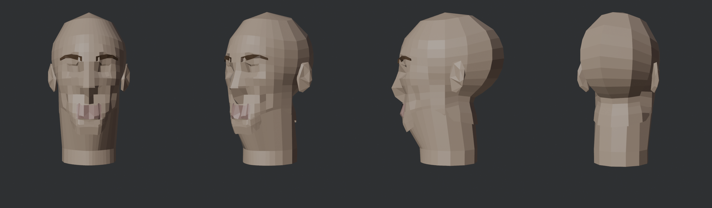
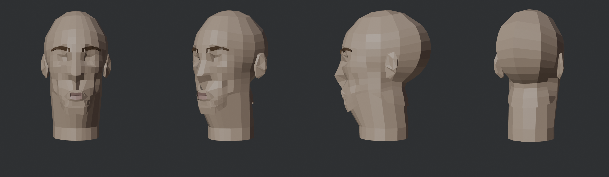
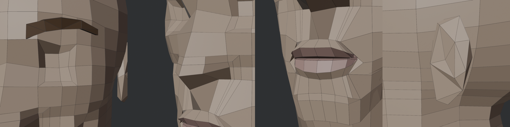
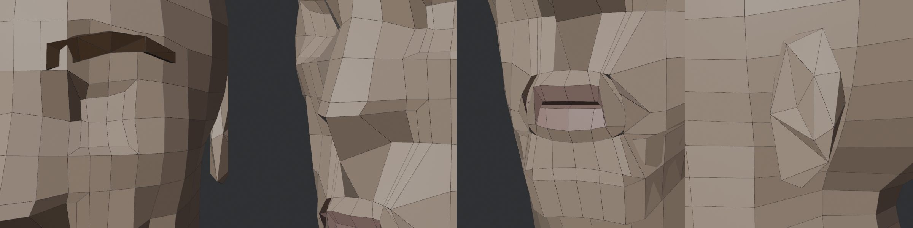
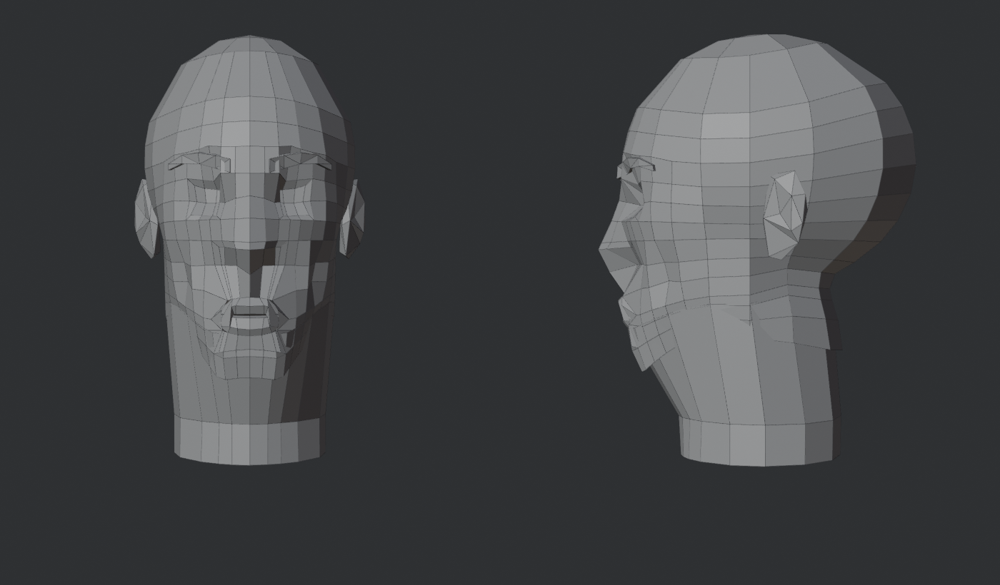
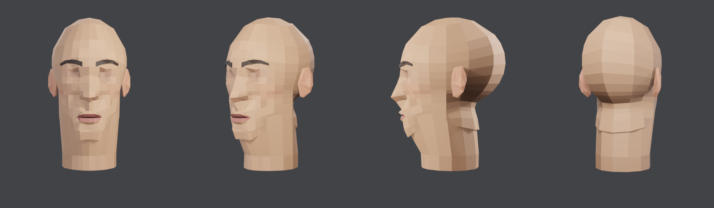
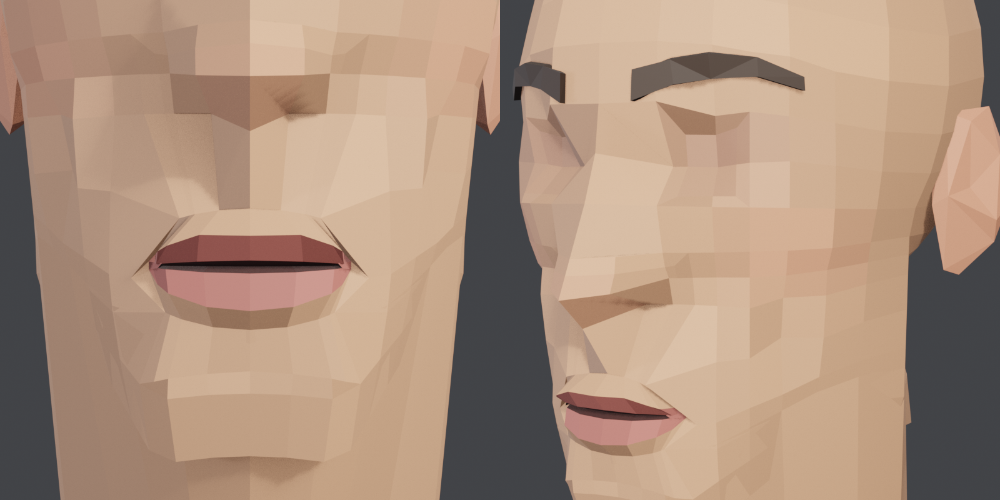
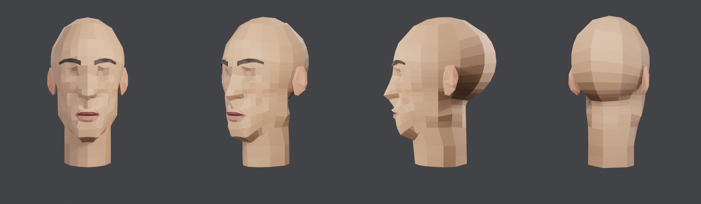
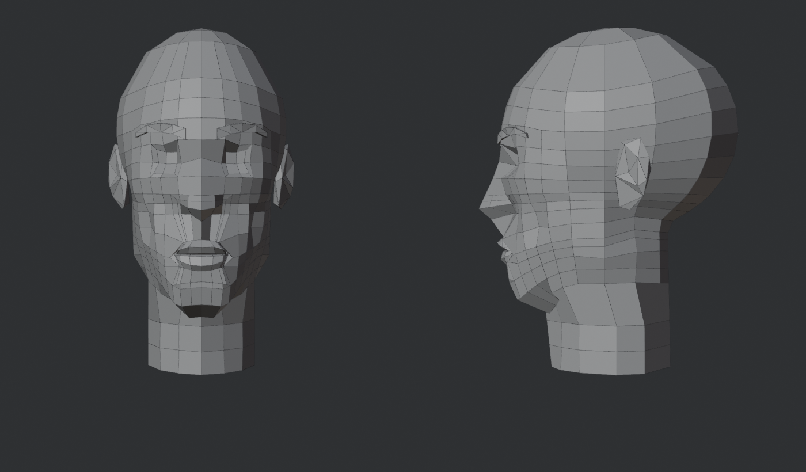

# Template topologi kepala (v1–v7)

Script: `tools/blender/head_template.py` (`TPL_TAG=tpl_v6` memberi nama output). Hasil: `output/head-game/template/`, render `renders/game_tpl_*`. Aturan desainnya dari [Topologi wajah low-poly](topologi-wajah-lowpoly.md).

## Ide
Topologi tidak dicari oleh remesh, tapi **dirancang**:
1. Grid kolom (azimut) × baris (sudut polar) dengan posisi di fitur wajah. Sinar ditembakkan dari dalam kepala ke permukaan SDF.
2. Tiap baris punya jumlah kolom sendiri. Kolom tipis wajah (6°, 17°, 29°, 48°) berhenti di dahi dan bawah dagu, dan transisinya jadi muka 5–6 sisi.
3. Inset bertingkat: **masker** (nasolabial) → **ring kulit bibir** → **bibir merah** → **celah mulut**. **Ring mata** kiri dan kanan terpisah.
4. Bibir dirancang di tampak depan (garis atas dengan busur Cupid, garis bawah, sudut terjepit), lalu diproyeksikan ke SDF dari depan.
5. Setengah kiri dibuang, sisi kanan dicerminkan, lalu di-weld supaya simetri sempurna.

## Riwayat

| Versi | Perubahan | Masalah yang terlihat |
|---|---|---|
| v1 | grid + inset masker, bibir, mata | kotak gelap di bawah hidung dan di bibir; kolom bergaris sampai ubun-ubun |
| v2 | jumlah kolom per baris; bibir dirancang di tampak depan | bagian dalam bibir gelap (vertex jatuh ke slot SDF); kotak di bawah hidung tetap |
| v3 | proyeksi radial gantikan Newton snap; garis mulut pakai rata-rata bibir atas dan bawah | kotak hilang; bibir jadi satu gumpalan tanpa garis |
| v4 | inset kedua: bibir merah + celah | celah terlalu lebar (baris atas salah klasifikasi); merge sudut membuat 2 edge non-manifold |
| v5 | klasifikasi celah lewat topologi; sudut dijepit tanpa merge | garis mulut terbaca, tertutup, simetris; bibir agak tenggelam dalam bingkai kulit; wajah masih kotak-kotak |
| **v6** | pita kolom (6° dan 17° hanya di moncong), baris ujung hidung (y −0.037), region dipilih lewat sudut dan tinggi, bibir merah maju 1.2–1.4 mm, sudut mulut masuk 1.5 mm | **bibir atas, bibir bawah, celah, dan sudut terbaca; hidung punya ujung; dahi lebih lebar; alis rapi**; leher masih bergaris; tepi gelap di samping hidung (ring masker) |
| **v7** | **baris rahang** dengan sudut per kolom (dari bawah dagu ke sudut rahang lalu tengkuk, selalu ≥ 12 mm di bawah baris atasnya); leher asli `head_sdf` (radius 46 mm, bukan 51 mm); kolom leher 10 | **garis rahang tegas, leher ramping, tonjolan belakang hilang**; 914 tris, 22 sliver, dihedral p95 76° (v6: 135°) |
| v8–v13 | telinga jadi part dirancang; v13 = trace langsung dari gambar wire user; kepala sama dengan v7 | detail di [kartu part telinga](parts/ear.md) |

v1:

v5:

v6:

v5 detail:

Angka (kepala + leher, tanpa bahu):

| | tris | quad | tertutup | dev mean / p95 | sliver |
|---|---|---|---|---|---|
| v5 | 930 | 92 % | ya | 0.80 / 3.60 mm | 62 |
| v6 | 918 | 92 % | ya | 0.77 / 3.45 mm | 26 |
| v7 | 914 | 91 % | ya | 0.79 / 3.47 mm | 22 |

## Pelajaran
- **Newton snap ke permukaan terdekat berbahaya di cekungan.** Di bawah hidung, permukaan terdekat adalah bawah hidung, sehingga philtrum naik. Proyeksikan sepanjang sinar yang sama dengan sinar yang membuat vertex (radial dari pusat kepala, horizontal untuk leher, dari depan untuk bibir).
- **Lekukan SDF yang tipis adalah jebakan.** Garis mulut di SDF berupa slot sedalam ±14 mm. Vertex yang diproyeksikan tepat di garis itu jatuh ke dasarnya. Ambil permukaan di atas dan di bawahnya lalu mundurkan sedikit.
- **Jangan merge vertex di sudut mulut.** Merge menghasilkan edge non-manifold. Rapatkan saja (0.4 mm per baris).
- **Klasifikasi vertex lewat topologi lebih aman daripada lewat tinggi.** Vertex interior celah = baris tengah.
- **Bibir harus maju dari permukaan.** Kalau semua vertex tepat di SDF, bibir low-poly terbaca tenggelam. Tepi bibir merah 1.2–1.4 mm ke depan, sudut mulut 1.5 mm ke dalam, ring kulit 0.3 mm ke dalam.
- **Pilih region lewat sudut dan tinggi, bukan indeks baris.** Menambah satu baris (ujung hidung) tidak merusak region mata, masker, dan bibir.
- **Satu baris dengan sudut tetap tidak bisa mengikuti rahang.** Rahang miring dari dagu (rendah, depan) ke sudut rahang (tinggi, samping). Baris rahang perlu sudut polar sendiri per kolom (bisection semua kolom sekaligus), dan dijaga tetap di bawah baris atasnya supaya baris tidak bersilangan di belakang.
- **Rak di tengkuk** muncul karena baris bawah dagu dengan sudut 128° jatuh di bawah tempurung, lalu baris leher langsung masuk ke dalam. Jadi tonjolan itu adalah bidang hampir datar di antara dua baris yang jaraknya jauh.
- **Leher SDF yang terlalu tebal menutupi rahang.** Bentuk dasar lebih penting daripada topologi: kalau SDF tidak punya sudut rahang, tidak ada edge yang bisa menampilkannya.
- **Kolom yang padat di wajah harus diakhiri** sebelum ubun-ubun dan leher. Kalau tidak, muncul garis vertikal di seluruh kepala.

## Penilaian user
- **3 Nov 2026: telinga v13 disetujui; BASELINE = kepala v7 + telinga v13.** `head_baseline*.glb/.blend` sekarang salinan `head_tpl_v13*` (kepala identik dengan v7: 914 tris; telinga 88 tris per telinga). Detail di [kartu part telinga](parts/ear.md).
- **3 Nov 2026: v7 = BASELINE** ("struktur ini bisa kita jadikan baseline"). File: `output/head-game/template/head_baseline.glb` (abu-abu) dan `head_baseline_color.glb` (berwarna), salinan dari `head_tpl_v7*`. Script `head_template.py` + `head_paint.py` pada kondisi ini adalah acuan. Semua perubahan berikutnya dibandingkan dengan baseline ini dan tidak boleh merusak mulut, rahang, dan leher.
- **3 Nov 2026: v6 disetujui** (close-up mata, hidung, mulut, telinga: "this one should be good"). Script `head_template.py` pada kondisi v6 menjadi acuan; perubahan berikutnya jangan merusak bentuk mulut v6.

## Versi berwarna (3 Nov 2026)
Script: `tools/blender/head_paint.py` (input `head_tpl_v6.blend`, output `head_tpl_v6_color.{blend,glb}` dan `renders/game_tpl_v6_color_*`).
- Satu warna per muka (atribut warna `Col`, domain FACE) dibaca satu material. Variasi kecerahan ±3.5 % per muka memberi kesan low-poly.
- Bibir dan celah mulut dari tag `lips` (2 = bibir merah, 1 = bagian dalam mulut). Alis cokelat tua, telinga warna hangat.
- Rongga mata, pipi, dan ujung hidung pakai **bercak lembut** (Gaussian dari titik pusat), bukan kotak. Batas keras membuat pipi terlihat seperti piksel.
- Render Eevee dengan 3 lampu area (key 22 W, fill 6 W, rim 18 W). Lampu 120 W membuat kepala putih total.
- **Jebakan**: atribut warna FLOAT_COLOR itu linear. Warna palet (sRGB) harus dikonversi dulu, kalau tidak hasilnya pucat.

Terlihat jelas di render warna v6: ada **tonjolan seperti rak di belakang leher**. Penilaian user (3 Nov): "great structure", tapi rahang kurang terlihat, leher sedikit lebar, dan ada tonjolan di belakang leher. Ketiganya diperbaiki di v7:

## Berikutnya (setelah v6)
1. ~~Leher dan rak belakang~~ selesai di v7.
2. Tepi gelap di samping hidung: tipiskan inset masker (4.5 mm terlalu lebar) atau geser ke sayap hidung.
3. Bahu: sambung ke leher atau pakai QuadriFlow untuk bagian itu.
4. Uji deformasi: shape key mulut membuka.
