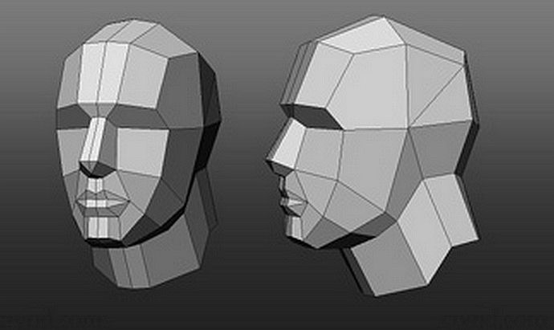
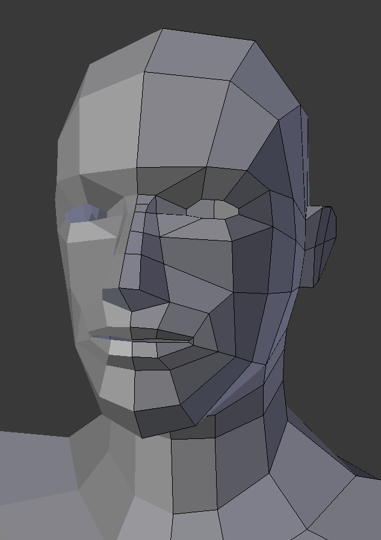
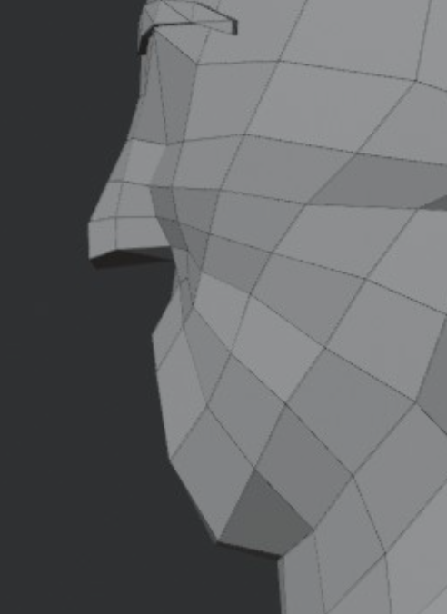

# Topologi wajah low-poly

Analisis 3 gambar referensi dari user (2 Nov 2026). Tujuannya jadi aturan untuk **template topologi tetap** kepala. Terkait: [Eksperimen topologi kepala](eksperimen-topologi-kepala.md), [Metode meshing](metode-meshing.md).

## Referensi

| | Gambar | Yang dipelajari |
|---|---|---|
| A |  | Kepala sangat low-poly. Seluruh kepala dari bidang besar. |
| B |  | Wajah low-poly di Blender: loop mata, loop mulut, garis rahang. |
| C |  | Samping hidung–mulut–dagu, semua quad. |

## Aturan yang terlihat

### 1. Kolom wajah mengikuti fitur
Garis vertikal wajah tidak dibagi rata. Tiap garis jatuh di tempat penting:
1. garis tengah;
2. sayap hidung dan sudut dalam mata;
3. tengah mata;
4. sudut luar mata;
5. sisi wajah dan tulang pipi;
6. depan telinga.

Hasilnya sekitar 5 kolom per sisi wajah. Di gambar A, dahi cuma 3 kolom lebar dan hidung adalah satu strip 2 kolom dari alis ke ujung hidung.

### 2. Baris wajah mengikuti fitur
Baris horizontal: garis rambut, alis (punggung alis), kelopak atas, kelopak bawah, pangkal hidung, bibir atas, celah mulut, bibir bawah, lipatan dagu, bawah dagu. Kurang lebih **10 baris**, sama dengan yang disarankan di [HANDOFF-lowpoly](../docs/HANDOFF-lowpoly.md) §6.

### 3. Loop melingkar (bagian yang belum kita punya)
- **Loop mata**: satu cincin quad di sekeliling bukaan mata (gambar B). Di versi eyeless, cincin ini membentuk rongga.
- **Loop mulut**: minimal 2 cincin. Cincin dalam adalah tepi bibir di sekitar celah. Cincin luar adalah batas bibir dengan kulit. Bibir atas 1 baris quad, bibir bawah 1 baris quad, dan **sudut mulut menyatu di satu vertex**.
- **Loop masker (nasolabial)**: edge dari sayap hidung turun melewati sudut mulut ke dagu (gambar B dan C). Edge ini memisahkan "moncong" (hidung, mulut, dagu) dari pipi. Inilah yang membuat mulut terbaca sebagai bentuk, bukan cuma warna.
- **Garis rahang**: satu edge dari dagu ke bawah telinga. Leher tumbuh dari sana.

### 4. Pole (vertex dengan 3 atau 5 edge)
Pole muncul di tempat loop mata dan loop mulut bertemu, yaitu di pipi, bukan di bibir atau kelopak. Di gambar B pole ada di pipi bawah mata dan di samping sudut mulut.

### 5. Bentuk hidung
Hidung berbentuk prisma: batang 2 kolom, ujung berupa kotak, bagian bawah datar dengan lubang hidung hanya berupa bayangan. Sayap hidung adalah satu quad miring ke pipi (gambar C).

### 6. Mulut
- Celah mulut adalah edge loop yang **masuk ke dalam** (inset). Bayangan gelapnya muncul dari geometri, bukan dari warna.
- Bibir atas maju sedikit dibanding bibir bawah (gambar C, tampak samping).
- Di bawah bibir bawah ada cekungan (labiomental), lalu dagu menonjol. Dua baris quad sudah cukup.

## Kenapa mulut kita masih kurang
Hasil collapse dan collapse_soft (lihat [eksperimen](eksperimen-topologi-kepala.md)) punya bentuk mulut dari SDF, tapi segitiganya tidak membentuk cincin. Akibatnya garis bibir terputus-putus dan sudut mulut tidak menyatu. Remesh otomatis tidak akan pernah membuat loop mulut, karena loop itu keputusan desain, bukan hasil kelengkungan.

**Solusi**: template topologi tetap, yaitu grid kolom dan baris di atas ditambah cincin mata dan cincin mulut. Lalu tiap vertex ditempel ke permukaan SDF dengan Newton snap (sudah ada: `snap_points` di `tools/blender/head_topo_lab.py`).
