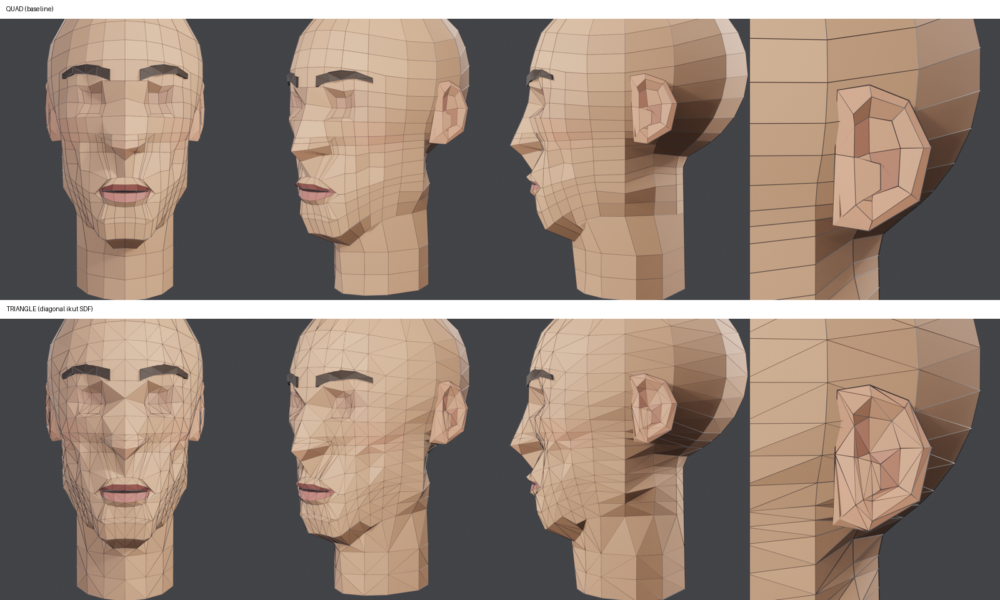
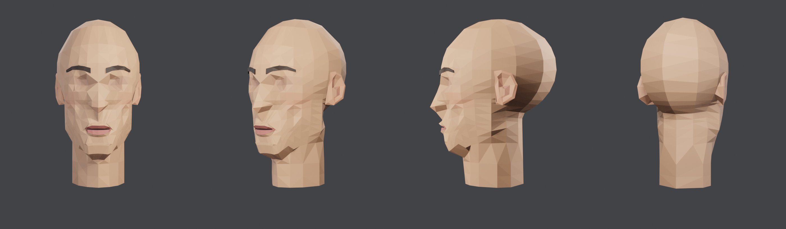

# Triangulasi: versi segitiga dari kepala quad

Permintaan user (3 Nov 2026): "yang quad segi empat udah bagus, yang triangle belum, coba buat."
Script: `tools/blender/head_tri.py` (sumber `head_baseline.blend`, hasil `head_tri_sdf.{blend,glb}`). Render wireframe: `tools/blender/wire_render.py`.

## Kenapa perlu
- Game engine (GPU) selalu menggambar segitiga. GLB/FBX dari quad akan dipecah otomatis saat ekspor/import, dan diagonalnya tidak bisa kita kontrol.
- **Satu quad bisa dibelah lewat 2 diagonal.** Pada flat shading, diagonal itu menjadi lipatan yang terlihat: lipatan "ke luar" (bukit) atau "ke dalam" (lembah). Diagonal yang salah membuat pipi penyok atau rongga mata menonjol.
- Quad tetap jadi sumber untuk diedit dan di-rig, karena loop terbaca. Versi segitiga adalah **hasil ekspor**.

## Cara memilih diagonal
| Metode | Aturan | Jarak titik tengah segitiga ke SDF (mean / p95) |
|---|---|---|
| **sdf** (dipakai) | pilih diagonal yang titik tengahnya paling dekat ke permukaan SDF kepala | **1.22 / 4.14 mm** |
| beauty (Blender) | pilih diagonal yang membuat sudut segitiga paling seimbang | 1.30 / 4.26 mm |
| fixed | selalu diagonal 0–2 | 1.35 / 4.42 mm |

- SDF simetris, jadi pilihan diagonal otomatis bercermin: **0 edge tanpa pasangan** dari 1371 edge.
- N-gon telinga (tragus 8 sisi, cekungan 7 sisi) dan alis tidak berada di SDF kepala, jadi dipecah dengan beauty.
- Jumlah segitiga sama: kepala 914, telinga 176 (88 per sisi), alis 36 per sisi. Triangulasi **tidak menambah beban** di game, hanya membuat pembagiannya eksplisit.
- Warna per muka sekarang per segitiga, sehingga variasi ±3.5 % membuat gaya faceted (low-poly segitiga) lebih kelihatan.

## Pelajaran
- **Quad untuk kerja, segitiga untuk ekspor.** Simpan template quad sebagai sumber, lalu buat versi segitiga dengan aturan yang bisa diulang.
- **Diagonal juga keputusan bentuk.** Kalau ada bentuk acuan (SDF), pilih diagonal yang paling dekat ke acuan itu. Tanpa acuan, beauty lebih baik daripada fixed.
- Terkait: [Template topologi kepala](template-topologi-kepala.md), [Ukuran kualitas mesh](ukuran-kualitas-mesh.md), [Pipeline AI image-to-3D](pipeline-ai-image-to-3d.md) (Meshy: quad mudah diedit, segitiga cocok untuk game engine).
